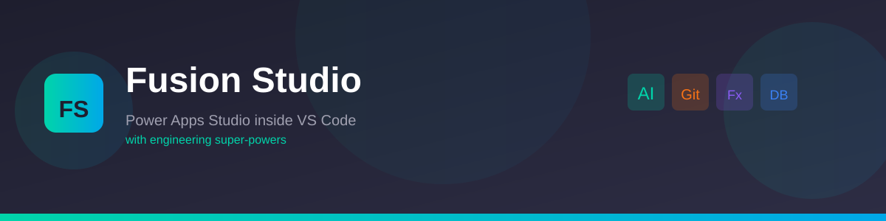
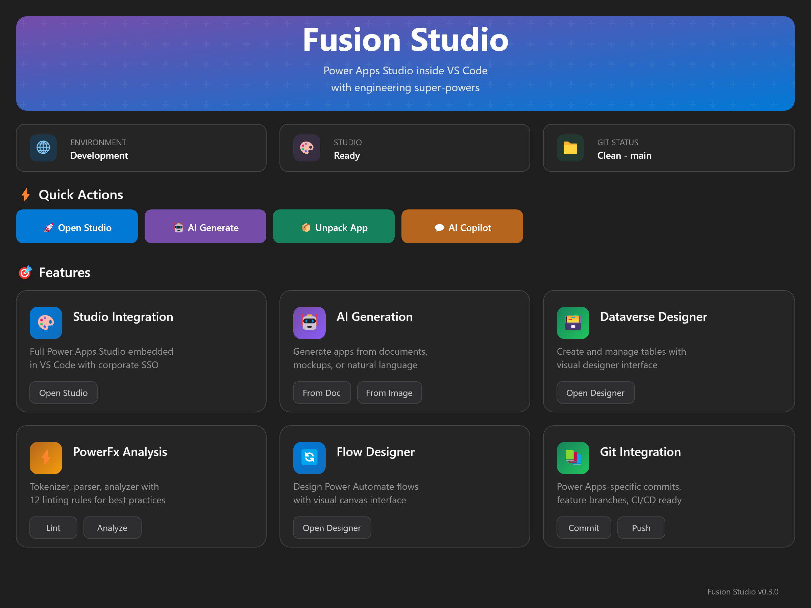
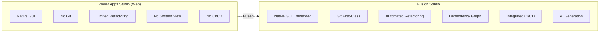
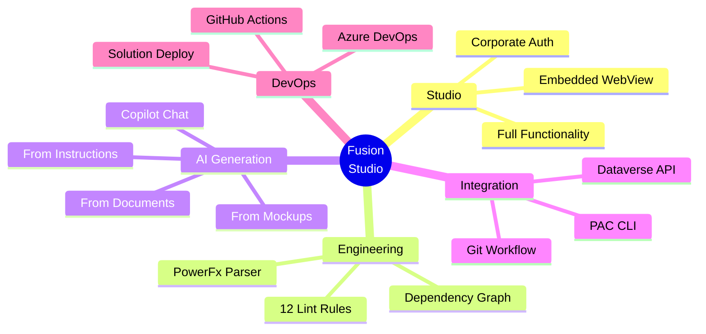
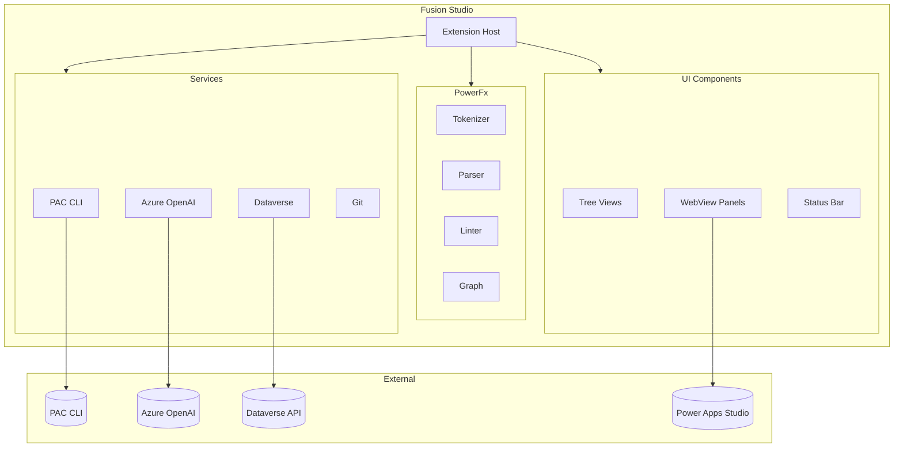
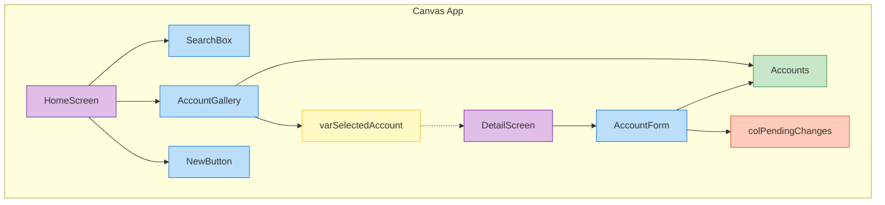
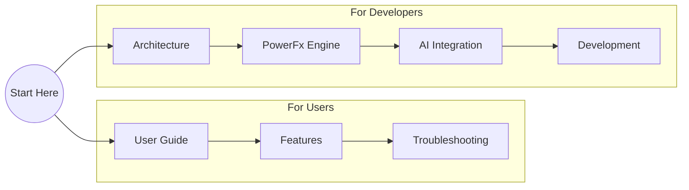

<p align="center">
  
</p>

<p align="center">
  <strong>Power Apps Studio inside VS Code - with engineering super-powers</strong>
</p>

<p align="center">
  A VS Code extension for Power Apps makers and pro developers who want to build Canvas Apps with Git, PowerFx linting, dependency graphs, Dataverse tooling and Azure OpenAI generation.
</p>

<p align="center">
  
</p>

<p align="center">
  <a href="https://marketplace.visualstudio.com/items?itemName=VladimiroLuis.powerapps-fusion-studio">
    
  </a>
  <a href="https://github.com/devladlog/Fusion-Studio/blob/main/LICENSE">
    
  </a>
  <a href="https://github.com/devladlog/Fusion-Studio/stargazers">
    
  </a>
  <a href="https://github.com/devladlog/Fusion-Studio/issues">
    
  </a>
</p>

<p align="center">
  <a href="#key-features">Features</a> -
  <a href="#quick-start">Quick Start</a> -
  <a href="#documentation">Documentation</a> -
  <a href="CONTRIBUTING.md">Contributing</a>
</p>

---



## Overview

**Fusion Studio** embeds the full Power Apps Studio experience inside VS Code, enabling professional developers to work with Canvas Apps using a Git-first workflow, AI-powered generation, and proper ALM tooling.

## Key Features



### 🎨 Embedded Power Apps Studio
Full Power Apps Studio in a VS Code WebView - no functionality loss.

### 🔍 PowerFx Analysis Engine
- **Tokenizer** - Lexical analysis of PowerFx formulas
- **Parser** - Abstract Syntax Tree generation
- **Analyzer** - Dependency extraction
- **Linter** - 12 rules for code quality
- **Dependency Graph** - Export to Mermaid, DOT, D2, JSON

### 🤖 AI-Powered Generation
- Generate Canvas Apps from documents (MD, TXT, PDF, DOCX)
- Generate from UI mockups/wireframes
- Generate from natural language instructions
- AI Copilot chat sidebar
- Canvas App analysis with AI insights

### 📊 Dataverse Integration
- Direct REST API integration
- Visual Table Designer
- Schema management
- Flow Designer

### 🔧 Git-First Workflow
- Power Apps-specific commit messages
- Feature branch creation
- Auto-sync with file watcher
- .gitignore templates

## Quick Start

1. **Install** - In VS Code open Extensions (`Ctrl+Shift+X`), search for **Power Apps Fusion Studio** and click **Install** (or install it from the [VS Code Marketplace](https://marketplace.visualstudio.com/items?itemName=VladimiroLuis.powerapps-fusion-studio)).
2. **Open the dashboard** - Press `Ctrl+Shift+P` and run **Power Apps: Open Fusion Studio Dashboard**.
3. **Connect and unpack** - Run **Power Apps: Select Environment**, then **Power Apps: Unpack Canvas App** to get your app as source files.

See the [Quick Start guide](docs/QUICKSTART.md) for prerequisites (PAC CLI, Azure OpenAI) and a longer walkthrough.

### Build from source

```powershell
git clone https://github.com/devladlog/Fusion-Studio.git
cd Fusion-Studio/extension
npm ci
npm run typecheck              # tsc type-check, no output files
npm run bundle                 # esbuild: src/extension.ts -> dist/extension.js (with sourcemap)
# Open the extension folder in VS Code and press F5 to launch an Extension Development Host

npx @vscode/vsce package       # build a .vsix (runs the minified production bundle first)
code --install-extension powerapps-fusion-studio-0.4.3.vsix
```

The extension ships as a single bundled file, `dist/extension.js`, with its runtime dependencies (axios, zod, mammoth, pdf-parse) inside it, so the `.vsix` contains no `node_modules`. See the [Development Guide](docs/DEVELOPMENT.md#building) for the full set of scripts.

## Architecture



## Commands

| Category | Command | Description |
|----------|---------|-------------|
| **Studio** | Open Power Apps Studio | Launch embedded Studio |
| **PAC CLI** | Unpack/Pack Canvas App | Convert .msapp ↔ source |
| **PAC CLI** | Select Environment | Switch environments |
| **PowerFx** | Lint Formula | Run linter on selection |
| **PowerFx** | Analyze Formula | Extract dependencies |
| **PowerFx** | Export Dependency Graph | Generate visualization |
| **Git** | Commit Power Apps Changes | Structured commits |
| **Git** | Create Feature Branch | New branch with prefix |
| **AI** | Generate from Document | AI app generation |
| **AI** | Generate from Mockup | Image to app |
| **AI** | Generate from Instructions | Text to app |
| **AI** | Open AI Copilot | Chat assistant |
| **Dataverse** | Open Designer | Visual table creator |

## Configuration

### Basic Settings

```json
{
    "powerapps.pacCliPath": "",
    "powerapps.defaultEnvironment": "",
    "powerapps.sourceFolder": "src"
}
```

### AI Settings (Azure OpenAI)

```json
{
    "powerapps.azureOpenAi.endpoint": "https://your-resource.openai.azure.com",
    "powerapps.azureOpenAi.deploymentName": "gpt-4"
}
```

Then run: **Power Apps: Set Azure OpenAI API Key** (stored securely)

### Linter Settings

```json
{
    "powerapps.linter.enabled": true,
    "powerapps.linter.maxComplexity": 10,
    "powerapps.linter.rules": {
        "no-hardcoded-environment": true,
        "max-formula-complexity": true,
        "no-deprecated-functions": true
    }
}
```

## Dependency Graph Example



## Documentation

### 📚 User Documentation

| Document | Description |
|----------|-------------|
| [📖 User Guide](docs/USER-GUIDE.md) | **Complete user guide** - Getting started, features, tutorials |
| [🎯 Features](docs/FEATURES.md) | **All features** - Commands, capabilities, configuration |
| [🔧 Troubleshooting](docs/TROUBLESHOOTING.md) | **Problem solving** - Common issues and solutions |

### 🏗️ Technical Documentation

| Document | Description |
|----------|-------------|
| [🏛️ Architecture](docs/ARCHITECTURE.md) | System design, components, data flow |
| [⚡ PowerFx Analysis](docs/POWERFX-ANALYSIS.md) | Parser, linter, dependency graph |
| [🤖 AI Integration](docs/AI-INTEGRATION.md) | Azure OpenAI, Dataverse setup |
| [👨‍💻 Development Guide](docs/DEVELOPMENT.md) | Contributing, extending, testing |

### Quick Links



## CI/CD

The repository ships two example pipelines for **your own Power Apps source repo** (an unpacked canvas app in `src/`). Copy them into your app repository. The GitHub Actions template lives in `templates/github-actions/`, outside `.github/workflows/`, so it never runs in this repository.

### GitHub Actions
```yaml
# templates/github-actions/powerapps-ci.yml -> copy to .github/workflows/ in your app repo
on:
  push:
    branches: [main, develop]
  pull_request:
    branches: [main]
  workflow_dispatch:

jobs:
  validate:                # lint PowerFx sources
  build:                   # pac canvas pack
  deploy-dev:              # deploy to development
  deploy-prod:             # deploy to production
  analyze:                 # dependency analysis
```

### Azure DevOps
```yaml
# .azure-pipelines/powerapps-pipeline.yml
trigger:
  - main

stages:
  - stage: Build
  - stage: Validate
  - stage: Deploy
```

## Requirements

- **VS Code** 1.85+
- **Node.js** 18+
- **Power Platform CLI** (PAC)
- **Azure OpenAI** (for AI features)
- **Power Platform** environment access

## Project Structure

```
Fusion-Studio/
├── docs/                      # Documentation
│   ├── USER-GUIDE.md          # Complete user guide
│   ├── FEATURES.md            # Feature reference
│   ├── TROUBLESHOOTING.md     # Problem solving
│   ├── ARCHITECTURE.md        # System design
│   ├── POWERFX-ANALYSIS.md    # Parser & linter docs
│   ├── AI-INTEGRATION.md      # AI setup guide
│   ├── DEVELOPMENT.md         # Developer guide
│   └── assets/                # Banner and screenshots
│
├── extension/                 # VS Code Extension
│   ├── src/
│   │   ├── extension.ts       # Entry point
│   │   ├── powerfx/           # Analysis engine
│   │   ├── services/          # Core services
│   │   ├── panels/            # WebView panels
│   │   ├── views/             # Tree providers
│   │   └── pipelines/         # AI pipelines
│   ├── resources/             # HTML templates, icons
│   │   ├── dashboard.html     # Main dashboard
│   │   ├── chatPanel.html     # AI Copilot
│   │   ├── dataverseDesigner.html
│   │   └── flowDesigner.html
│   ├── esbuild.js             # Bundles src/ into dist/extension.js
│   └── package.json           # Extension manifest
│
├── templates/github-actions/  # CI/CD template for your own app repo
├── .github/                   # Publish workflow, issue templates
├── .azure-pipelines/          # Azure DevOps template
├── CONTRIBUTING.md
└── LICENSE
```

## Roadmap

### Released

See the [changelog](extension/CHANGELOG.md) for details.

- **0.1.0** (2025-09) - Embedded Studio, PAC CLI integration, unpack/pack
- **0.2.0** (2025-12) - PowerFx parser, linter and dependency graph, Git-first workflow
- **0.3.x** (2026-04) - Azure OpenAI generation, AI Copilot, Dataverse and Flow designers
- **0.4.x** (2026-06) - Published on the Marketplace as Power Apps Fusion Studio (`VladimiroLuis.powerapps-fusion-studio`), refreshed Marketplace page; 0.4.3 bundles the runtime dependencies so the Marketplace build activates

### Planned

- PowerFx IntelliSense
- Real-time collaboration
- Plugin system

## Contributing

1. Fork the repository
2. Create feature branch: `git checkout -b feature/amazing-feature`
3. Commit changes: `git commit -m 'Add amazing feature'`
4. Push branch: `git push origin feature/amazing-feature`
5. Open Pull Request

See [CONTRIBUTING.md](CONTRIBUTING.md) and the [Development Guide](docs/DEVELOPMENT.md) for detailed instructions.

## License

MIT License - see [LICENSE](LICENSE) for details.

## Acknowledgments

- Microsoft Power Platform team
- Azure OpenAI team
- VS Code Extension API team
