# AI & Dataverse Integration

## Overview

**Fusion Studio** integrates with Azure OpenAI for intelligent app generation and Dataverse for direct data modeling. These services enable a powerful low-code to pro-code workflow.

## AI Generation Architecture

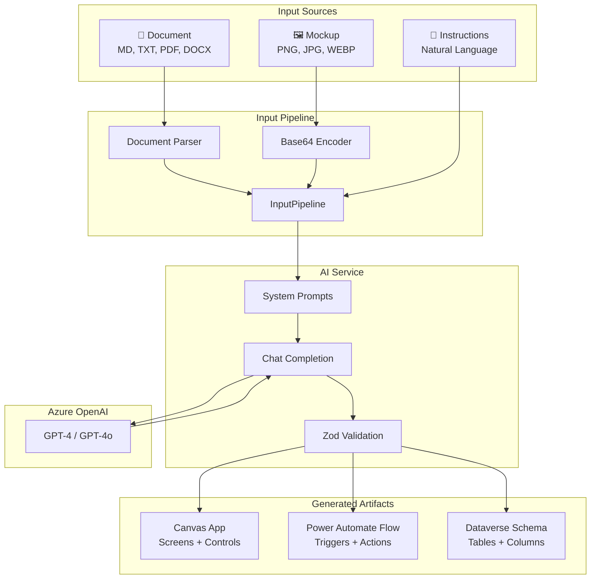

## Azure OpenAI Configuration

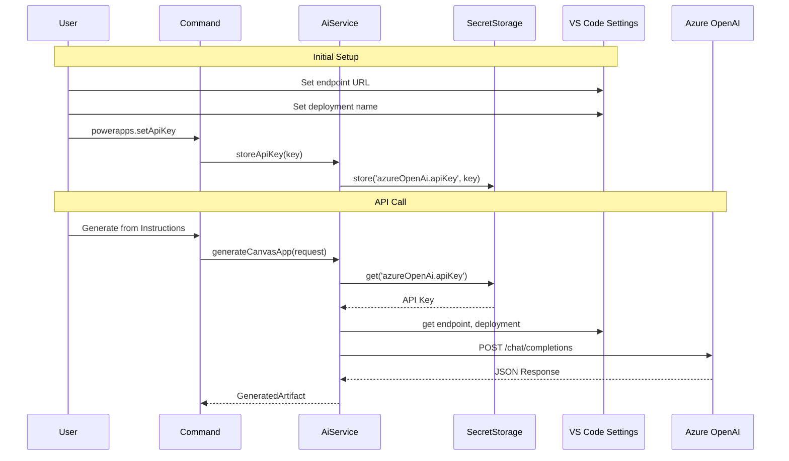

## Generation Request Types

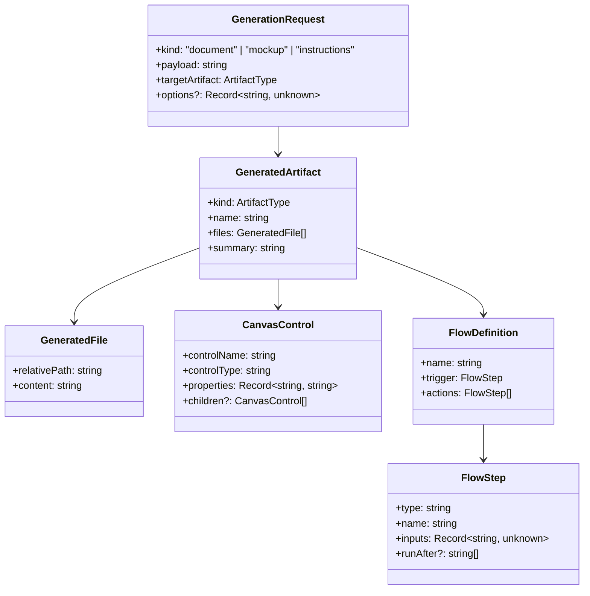

## System Prompts

### Canvas App Generation

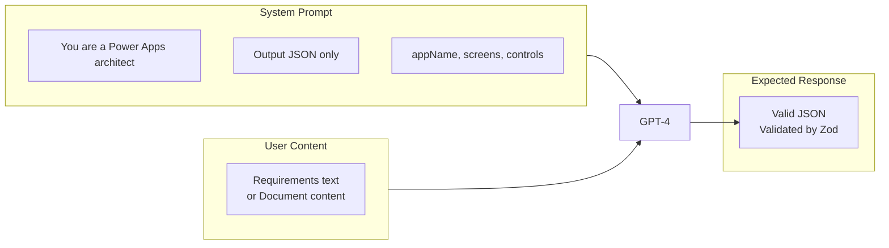

### Flow Generation

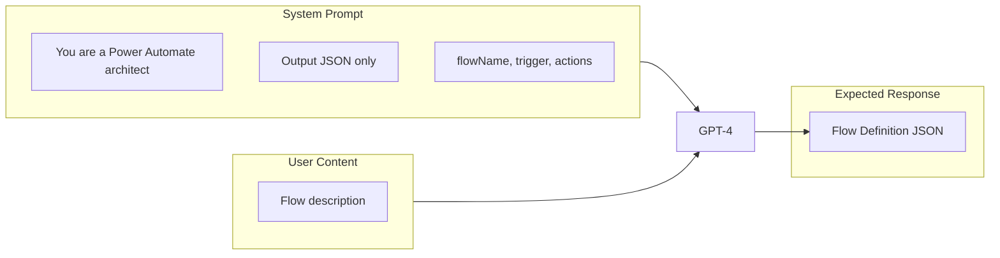

## Response Validation with Zod

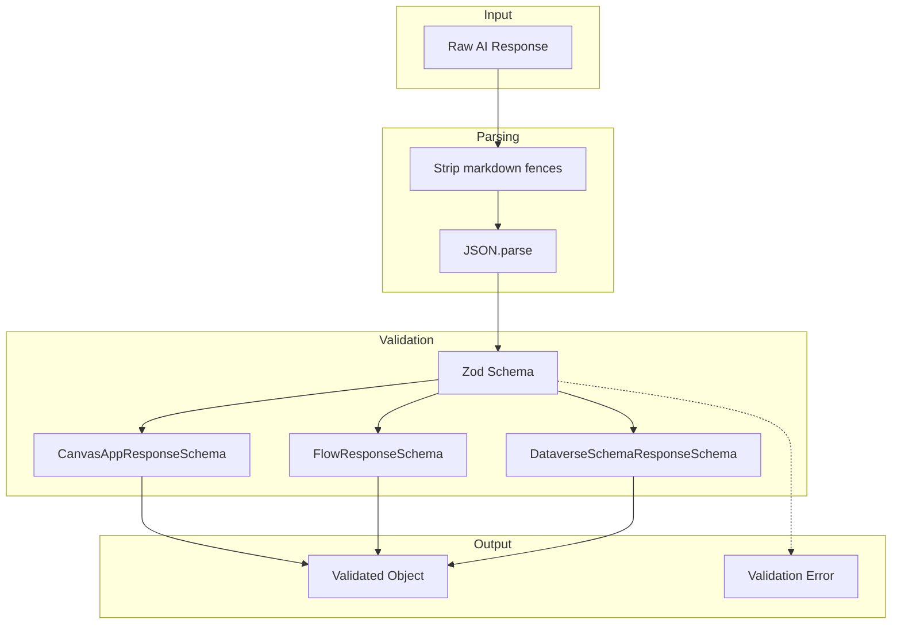

## Dataverse Integration

```mermaid
flowchart TB
    subgraph Extension
        DV[DataverseService]
        CLIENT[Axios Client]
    end
    
    subgraph Auth["Authentication"]
        TOKEN[Access Token]
        CMD[getAccessToken Command]
    end
    
    subgraph API["Dataverse REST API v9.2"]
        ENTITY[/EntityDefinitions]
        ATTR[/Attributes]
        REL[/Relationships]
    end
    
    subgraph Operations
        LIST[List Tables]
        CREATE[Create Table]
        COLS[Add Columns]
        READ[Get Schema]
    end
    
    DV --> CMD --> TOKEN
    TOKEN --> CLIENT --> API
    
    LIST --> ENTITY
    CREATE --> ENTITY
    COLS --> ATTR
    READ --> ENTITY
```

## Dataverse Designer Panel

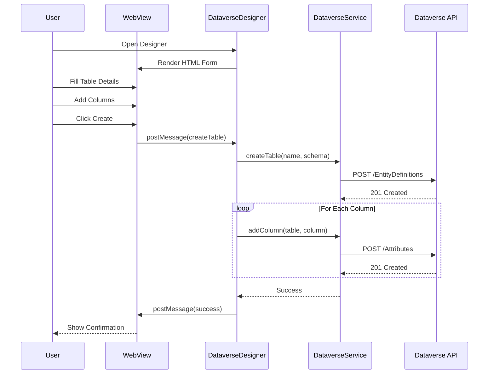

## Dataverse Types

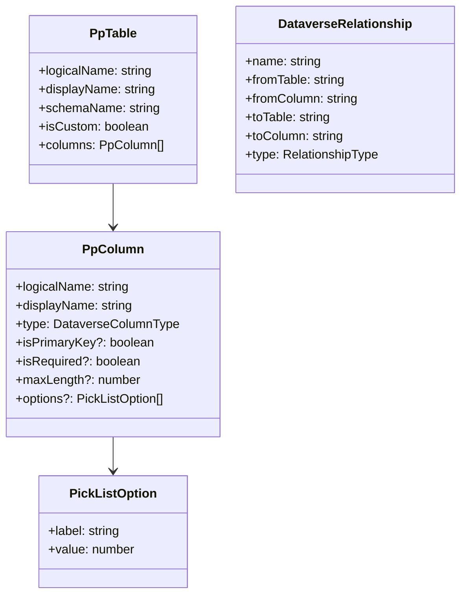

## Column Type Mapping

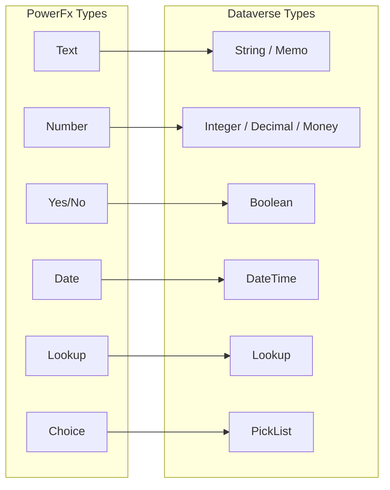

## Error Handling & Retry

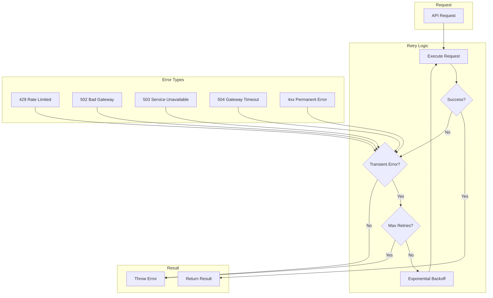

## Security Best Practices

```mermaid
flowchart TB
    subgraph Secrets["Secret Management"]
        KEY[API Key]
        SS[SecretStorage]
        OS[OS Keychain]
    end
    
    subgraph Transport["Transport Security"]
        TLS[HTTPS Only]
        HEADER[Authorization Header]
    end
    
    subgraph Validation["Input Validation"]
        URL[URL Validation]
        SIZE[File Size Limits]
        SCHEMA[Schema Validation]
    end
    
    subgraph Tokens["Token Management"]
        REFRESH[Auto-Refresh]
        EXPIRE[Expiry Check]
        BUFFER[5-min Buffer]
    end
    
    KEY --> SS --> OS
    
    TLS --> HEADER
    
    URL --> SIZE --> SCHEMA
    
    REFRESH --> EXPIRE --> BUFFER
```

## Chat Panel (AI Copilot)

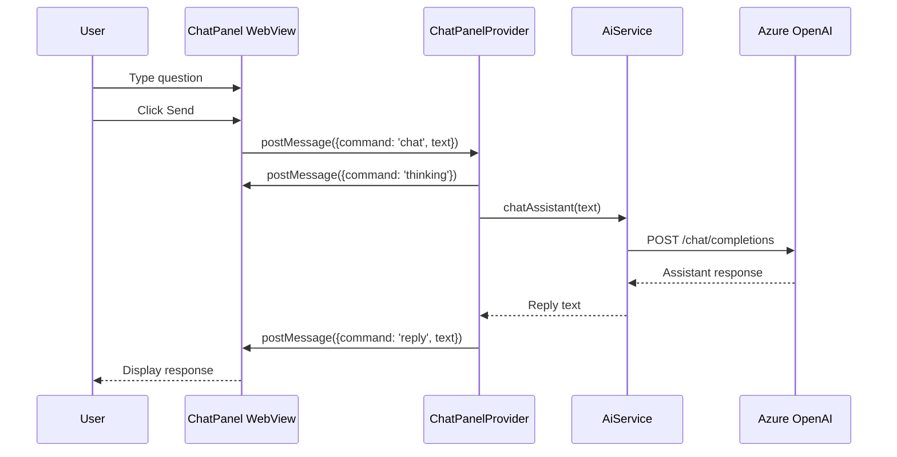

## Configuration Reference

| Setting | Type | Default | Description |
|---------|------|---------|-------------|
| `powerapps.azureOpenAi.endpoint` | string | "" | Azure OpenAI endpoint URL |
| `powerapps.azureOpenAi.deploymentName` | string | "" | Model deployment name |
| `powerapps.azureOpenAi.apiKey` | string | "" | API key (prefer SecretStorage) |
| `powerapps.dataverseUrl` | string | "" | Dataverse environment URL |

## Usage Examples

### Generate Canvas App from Instructions

```typescript
// Command: powerapps.generateFromInstructions
const instructions = "Create a simple contact form with name, email, and message fields";
await inputPipeline.fromInstructions();

// Result: Generated files saved to workspace
// - src/Screens/ContactScreen.yaml
// - src/Controls/NameInput.yaml
// - src/Controls/EmailInput.yaml
// - src/Controls/MessageInput.yaml
// - src/Controls/SubmitButton.yaml
```

### Generate from Mockup

```typescript
// Command: powerapps.generateFromMockup
const mockupPath = '/path/to/wireframe.png';
await inputPipeline.fromMockup(vscode.Uri.file(mockupPath));

// AI interprets the image and generates matching controls
```

### Create Dataverse Table

```typescript
// Using DataverseDesignerPanel
DataverseDesignerPanel.show(extensionUri, dataverseService);

// Or programmatically:
await dataverseService.createTable(
  'Contacts',
  'new_contacts',
  'Contact information',
  'new_name'
);

await dataverseService.addColumn('new_contacts', {
  logicalName: 'new_email',
  displayName: 'Email Address',
  type: 'String',
  isRequired: true,
  maxLength: 100
});
```
