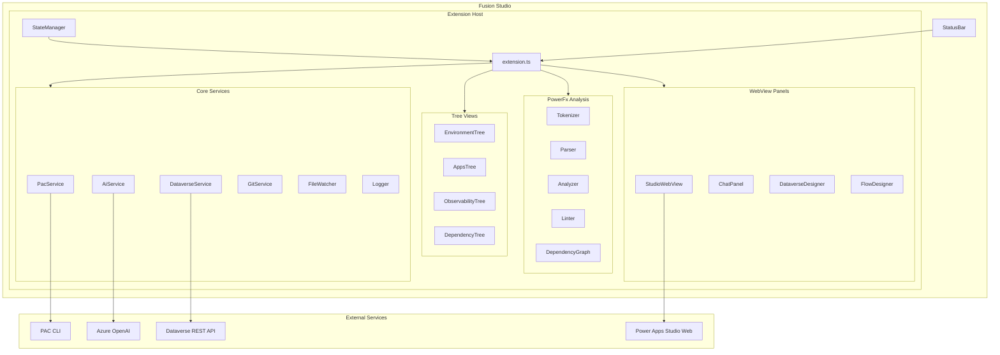
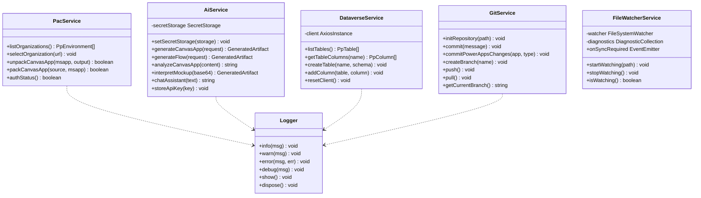
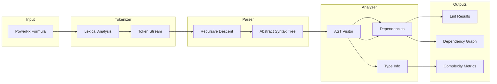
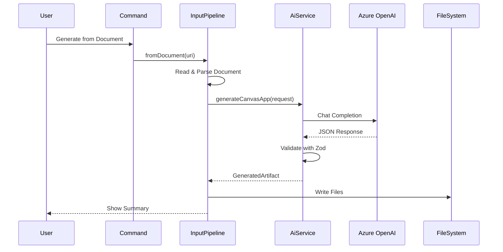
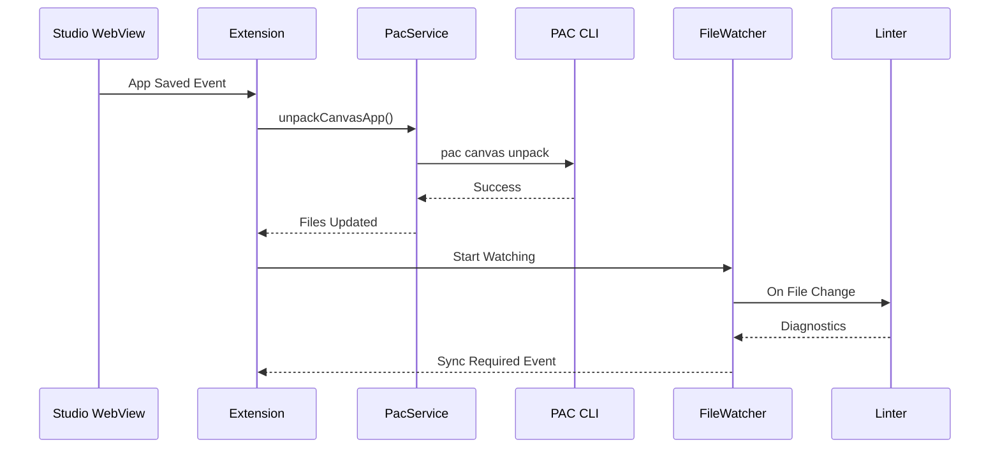
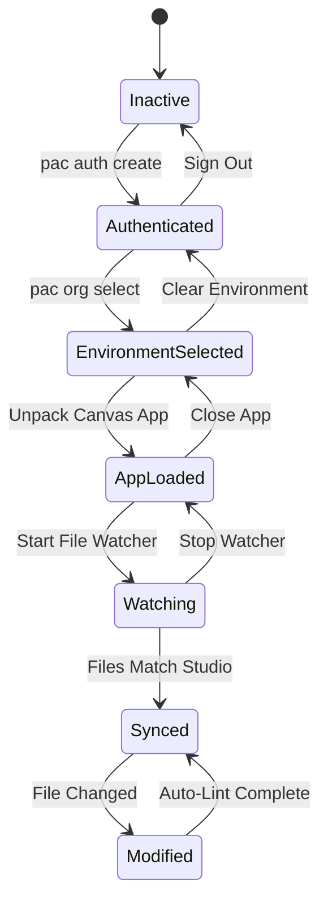
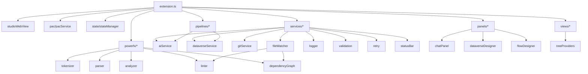
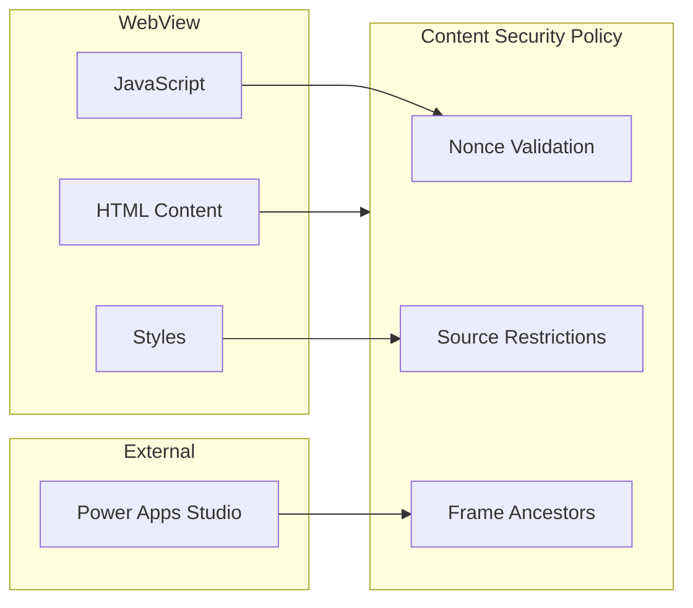
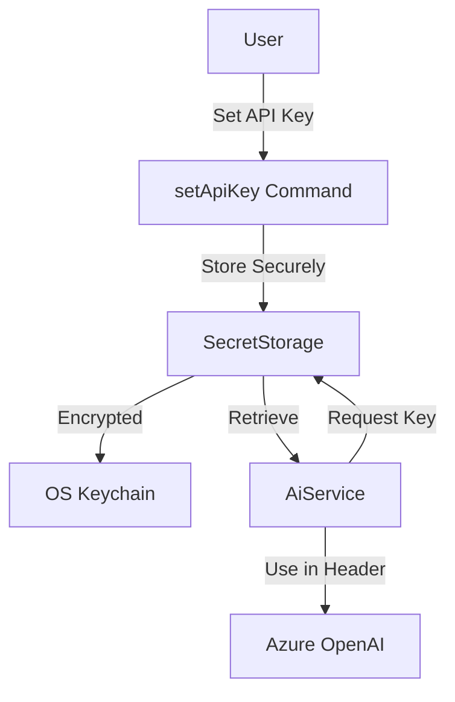

# Fusion Studio - Architecture Documentation

## Overview

**Fusion Studio** is a comprehensive VS Code extension that brings the full Power Apps development experience into VS Code, enhanced with engineering capabilities not available in the web-based Studio.

## High-Level Architecture



## Component Responsibilities

### Extension Entry Point (`extension.ts`)

The main activation point that:
- Initializes all services
- Registers commands (30+)
- Sets up tree view providers
- Configures webview panels
- Manages extension lifecycle

### Services Layer



### PowerFx Analysis Pipeline



## Data Flow

### App Generation Flow



### Canvas App Sync Flow



## State Management



## Module Dependencies



## Security Considerations

### Content Security Policy (WebView)



### Secret Storage



## File Structure

```
extension/
├── src/
│   ├── extension.ts           # Main entry point
│   ├── studioWebView.ts       # Power Apps Studio embedding
│   ├── types.ts               # Shared type definitions
│   │
│   ├── pac/                   # PAC CLI Integration
│   │   └── pacService.ts
│   │
│   ├── powerfx/               # PowerFx Analysis
│   │   ├── tokenizer.ts       # Lexical analysis
│   │   ├── parser.ts          # AST generation
│   │   ├── analyzer.ts        # Dependency extraction
│   │   ├── linter.ts          # Static analysis rules
│   │   ├── dependencyGraph.ts # Graph operations
│   │   └── index.ts           # Barrel export
│   │
│   ├── services/              # Core Services
│   │   ├── aiService.ts       # Azure OpenAI
│   │   ├── dataverseService.ts# Dataverse REST API
│   │   ├── gitService.ts      # Git operations
│   │   ├── fileWatcher.ts     # File monitoring
│   │   ├── statusBar.ts       # Status bar UI
│   │   ├── logger.ts          # Logging
│   │   ├── retry.ts           # Retry utility
│   │   ├── validation.ts      # Input validation
│   │   └── index.ts           # Barrel export
│   │
│   ├── panels/                # WebView Panels
│   │   ├── chatPanel.ts       # AI Copilot
│   │   ├── dataverseDesigner.ts
│   │   ├── flowDesigner.ts
│   │   ├── webviewUtils.ts    # CSP, nonce helpers
│   │   └── index.ts
│   │
│   ├── pipelines/             # Processing Pipelines
│   │   ├── inputPipeline.ts   # Document/Mockup/Instructions
│   │   └── index.ts
│   │
│   ├── views/                 # Tree View Providers
│   │   └── treeProviders.ts
│   │
│   ├── state/                 # State Management
│   │   └── stateManager.ts
│   │
│   └── test/                  # Test Suite
│       └── suite/
│
├── resources/                 # Static Assets
│   ├── chatPanel.html
│   ├── dataverseDesigner.html
│   ├── flowDesigner.html
│   ├── icon.svg
│   ├── logo.png
│   └── powerapps.png
│
├── .vscode/                   # VS Code Config
├── .github/                   # CI/CD (GitHub Actions)
├── .azure-pipelines/          # CI/CD (Azure DevOps)
└── package.json               # Extension Manifest
```

## Extension Points

### Commands

The extension registers 30+ commands in the `powerapps.*` namespace:

| Category | Commands |
|----------|----------|
| Studio | openStudio |
| PAC CLI | unpackApp, packApp, selectEnvironment, authStatus |
| PowerFx | lintFormula, analyzeFormula, exportDependencyGraph |
| Git | gitInit, gitCommit, gitCommitPowerApps, gitCreateBranch, gitPush, gitPull |
| AI | generateFromDocument, generateFromMockup, generateFromInstructions, analyzeCanvasApp |
| Panels | openChatPanel, openDataverseDesigner, openFlowDesigner |
| Utility | refreshEnvironments, refreshApps, clearState, toggleWatcher |

### Configuration

All settings are under the `powerapps.*` namespace in VS Code settings.

### Tree Views

- `powerapps.environments` - Power Platform environments
- `powerapps.apps` - Canvas app structure
- `powerapps.dependencies` - Data sources and variables
- `powerapps.observability` - Live studio state
- `powerapps.chatPanel` - AI Copilot sidebar
