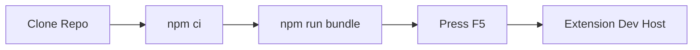
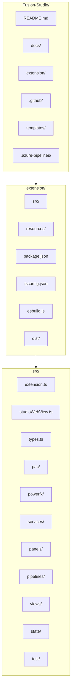
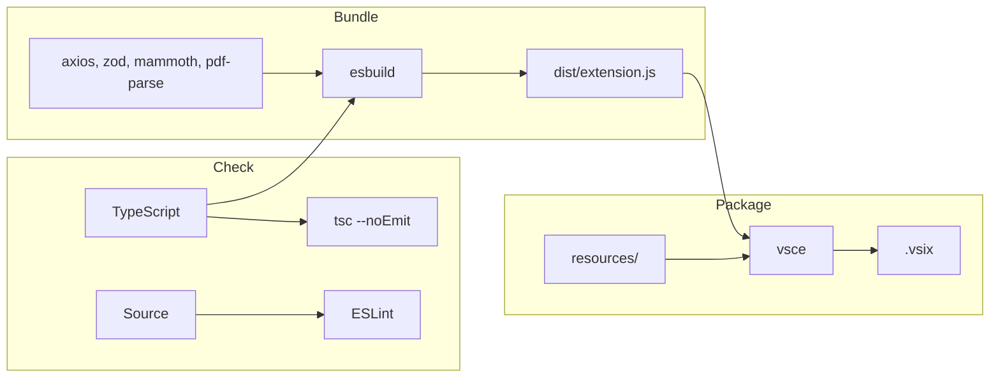
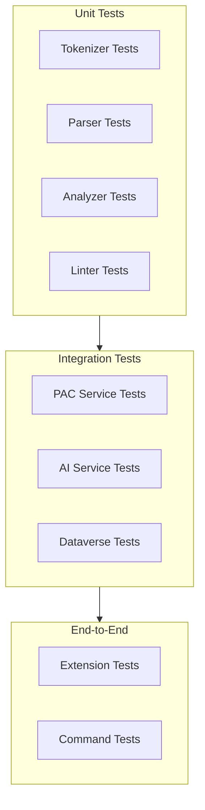
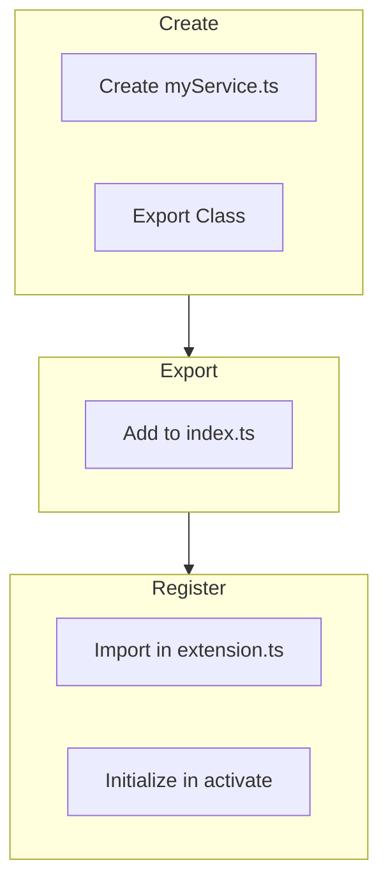
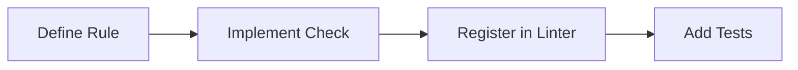
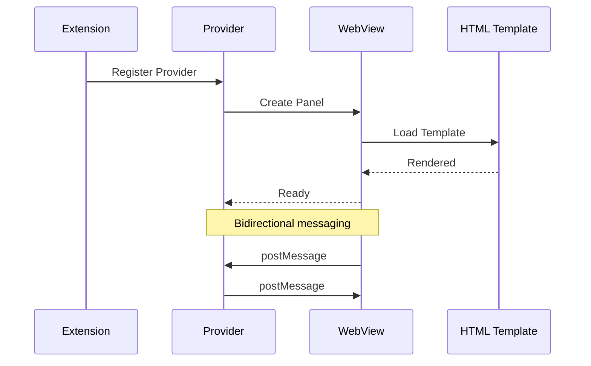
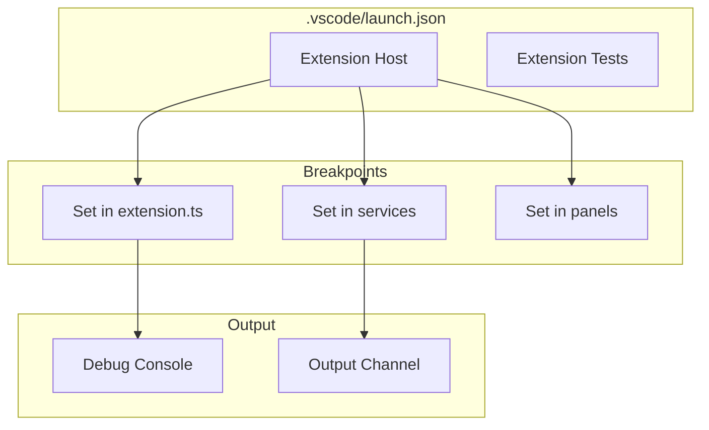
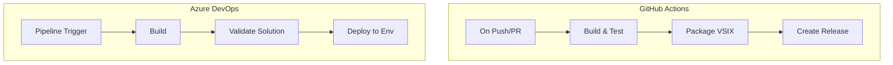
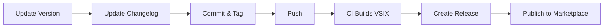

# Development Guide

## Prerequisites

- Node.js 18+
- VS Code 1.85+
- Power Platform CLI (PAC)
- Git

## Quick Start



```powershell
# Clone and setup
git clone https://github.com/devladlog/Fusion-Studio.git
cd Fusion-Studio/extension
npm ci

# Type-check and bundle
npm run typecheck
npm run bundle

# Run (Press F5 in VS Code - the default build task keeps dist/ up to date in watch mode)
```

## Project Structure



## Development Workflow

```mermaid
gitgraph
    commit id: "main"
    branch feature/my-feature
    checkout feature/my-feature
    commit id: "Add feature"
    commit id: "Add tests"
    commit id: "Update docs"
    checkout main
    merge feature/my-feature
    commit id: "Release"
```

### Branch Naming

- `feature/*` - New features
- `bugfix/*` - Bug fixes
- `refactor/*` - Code improvements
- `docs/*` - Documentation updates

## Building

The extension is bundled with [esbuild](https://esbuild.github.io/). `esbuild.js` bundles `src/extension.ts` and its runtime dependencies (axios, zod, mammoth, pdf-parse) into a single CommonJS file, `dist/extension.js`, which is the `main` entry in `package.json`. Only `vscode` stays external. The packaged `.vsix` therefore ships no `node_modules`; `.vscodeignore` excludes them along with `src/`, `out/` and source maps. TypeScript (`tsc`) is used only for type-checking and for compiling the tests.



```powershell
# Type-check (no output files)
npm run typecheck

# Bundle for development (dist/extension.js + sourcemap)
npm run bundle

# Bundle for production (minified, no sourcemap)
npm run bundle:prod

# Watch mode: esbuild rebuilds dist/ on change; tsc reports type errors
npm run watch
npm run watch:tsc

# Lint
npm run lint
npm run lint:fix

# Package a .vsix. vsce runs "vscode:prepublish" (typecheck + bundle:prod) first.
npx @vscode/vsce package          # or: npm run package
```

| Script | Command | Purpose |
|--------|---------|---------|
| `bundle` | `node esbuild.js` | Development bundle with sourcemap |
| `bundle:prod` | `node esbuild.js --production` | Minified bundle used for the `.vsix` |
| `typecheck` | `tsc -p ./ --noEmit` | Type-check only |
| `compile` | `tsc -p ./` | Emit `out/` (needed by the tests) |
| `watch` / `watch:tsc` | esbuild / tsc in watch mode | Used by the default VS Code build task (F5) |
| `vscode:prepublish` | `typecheck` + `bundle:prod` | Run automatically by `vsce package` and `vsce publish` |

Do not use `vsce package --no-dependencies` as a workaround; it is not needed now that nothing is loaded from `node_modules` at runtime. To check a package, list it with `npx @vscode/vsce ls` or open the `.vsix` as a zip: it should contain `extension/dist/extension.js` and `extension/resources/`, and no `extension/node_modules/`.

When you add a runtime dependency, add it to `dependencies` and import it with a static string (`import x from 'pkg'` or `require('pkg')`) so esbuild can bundle it. Dependencies that read their own files from disk at runtime need extra handling in `esbuild.js` (see the pdf-parse plugin there).

## Testing



```powershell
# Run tests (pretest compiles out/ with tsc and builds dist/ with esbuild)
npm test

# Run specific test file
npm test -- --grep "tokenizer"
```

## Adding a New Command

### 1. Define in package.json

```json
{
  "contributes": {
    "commands": [
      {
        "command": "powerapps.myNewCommand",
        "title": "My New Command",
        "category": "Power Apps"
      }
    ]
  }
}
```

### 2. Register in extension.ts

```typescript
context.subscriptions.push(
    vscode.commands.registerCommand('powerapps.myNewCommand', async () => {
        // Implementation
        vscode.window.showInformationMessage('Hello!');
    })
);
```

### 3. Add Menu Entry (Optional)

```json
{
  "menus": {
    "commandPalette": [
      {
        "command": "powerapps.myNewCommand",
        "when": "editorIsOpen"
      }
    ]
  }
}
```

## Adding a New Service



### 1. Create Service File

```typescript
// src/services/myService.ts
import { logger } from './logger';

export class MyService {
    async doSomething(): Promise<void> {
        logger.info('Doing something...');
    }
}
```

### 2. Export from Index

```typescript
// src/services/index.ts
export { MyService } from './myService';
```

### 3. Register in Extension

```typescript
// extension.ts
import { MyService } from './services';

let myService: MyService;

export function activate(context: vscode.ExtensionContext) {
    myService = new MyService();
    // ...
}
```

## Adding a New Lint Rule



### 1. Define Rule Interface

```typescript
interface LintRule {
    id: string;
    name: string;
    description: string;
    severity: 'error' | 'warning' | 'info' | 'hint';
    check: (ast: ExpressionNode) => LintDiagnostic[];
}
```

### 2. Implement Check

```typescript
const myRule: LintRule = {
    id: 'my-custom-rule',
    name: 'My Custom Rule',
    description: 'Checks for something specific',
    severity: 'warning',
    check: (ast) => {
        const diagnostics: LintDiagnostic[] = [];
        // Visit AST and collect issues
        return diagnostics;
    }
};
```

### 3. Register Rule

```typescript
// In linter.ts
const RULES: LintRule[] = [
    // ... existing rules
    myRule
];
```

## Adding a WebView Panel



### 1. Create Provider Class

```typescript
// src/panels/myPanel.ts
export class MyPanel {
    public static readonly viewType = 'powerapps.myPanel';
    
    public static show(extensionUri: vscode.Uri): MyPanel {
        const panel = vscode.window.createWebviewPanel(
            MyPanel.viewType,
            'My Panel',
            vscode.ViewColumn.One,
            { enableScripts: true }
        );
        return new MyPanel(panel, extensionUri);
    }
    
    private constructor(panel: vscode.WebviewPanel, extensionUri: vscode.Uri) {
        panel.webview.html = this.getHtml(panel.webview);
        panel.webview.onDidReceiveMessage(this.handleMessage);
    }
}
```

### 2. Create HTML Template

```html
<!-- resources/myPanel.html -->
<!DOCTYPE html>
<html>
<head>
    <meta {{CSP}}>
</head>
<body>
    <h1>My Panel</h1>
    <script nonce="{{NONCE}}">
        const vscode = acquireVsCodeApi();
        // ...
    </script>
</body>
</html>
```

### 3. Register Command

```typescript
context.subscriptions.push(
    vscode.commands.registerCommand('powerapps.openMyPanel', () => {
        MyPanel.show(context.extensionUri);
    })
);
```

## Debugging



### Launch Configurations

```json
{
    "configurations": [
        {
            "name": "Run Extension",
            "type": "extensionHost",
            "request": "launch",
            "args": ["--extensionDevelopmentPath=${workspaceFolder}"]
        },
        {
            "name": "Extension Tests",
            "type": "extensionHost",
            "request": "launch",
            "args": [
                "--extensionDevelopmentPath=${workspaceFolder}",
                "--extensionTestsPath=${workspaceFolder}/out/test/suite/index"
            ]
        }
    ]
}
```

### Using Logger

```typescript
import { logger } from './services';

logger.info('Something happened');
logger.warn('Warning message');
logger.error('Error occurred', error);
logger.debug('Debug info');

// Show output channel
logger.show();
```

## CI/CD



### GitHub Actions Workflows

- `.github/workflows/publish.yml` type-checks and bundles the extension, packages a `.vsix`, publishes that `.vsix` to the VS Code Marketplace and attaches it to a GitHub Release when a `v*` tag is pushed (see [Release Process](#release-process)).
- `templates/github-actions/powerapps-ci.yml` is a template for **your own Power Apps app repo**: it lints PowerFx sources, runs `pac canvas pack` and deploys. It does not run in this repository; copy it to `.github/workflows/` in your app repo.

### Azure DevOps Pipeline

Located at `.azure-pipelines/powerapps-pipeline.yml`:
- Multi-stage deployment
- Environment-specific validation
- Approval gates for production

## Code Style

### TypeScript Guidelines

```typescript
// ✅ Good
export class MyService {
    private readonly config: Config;
    
    async doSomething(): Promise<Result> {
        // ...
    }
}

// ❌ Bad
export class myservice {
    config: any;
    
    doSomething(): any {
        // ...
    }
}
```

### Naming Conventions

| Type | Convention | Example |
|------|------------|---------|
| Classes | PascalCase | `MyService` |
| Interfaces | PascalCase (I prefix optional) | `Config` or `IConfig` |
| Functions | camelCase | `doSomething` |
| Constants | UPPER_SNAKE | `MAX_RETRIES` |
| Files | camelCase | `myService.ts` |

### Error Handling

```typescript
try {
    await riskyOperation();
} catch (err) {
    const message = err instanceof Error ? err.message : String(err);
    logger.error('Operation failed', err);
    vscode.window.showErrorMessage(`Failed: ${message}`);
}
```

## Release Process



1. Update version in `package.json`
2. Update `CHANGELOG.md`
3. Commit: `git commit -m "Release v0.x.0"`
4. Tag: `git tag v0.x.0`
5. Push: `git push && git push --tags`
6. CI creates GitHub Release with VSIX
7. Publish to VS Code Marketplace

Pushing a `v*` tag runs [`.github/workflows/publish.yml`](../.github/workflows/publish.yml). It runs `npm ci`, the type-check and the production bundle, builds the `.vsix` with `npx @vscode/vsce package`, then publishes that same file with `npx @vscode/vsce publish --packagePath`. The Marketplace token is read from the `VSCE_PAT` environment variable, which the workflow fills from the `VSCE_PAT` repository secret, so it never appears on a command line. Add a Marketplace Personal Access Token as that secret before you push a tag. To publish by hand instead:

```bash
cd extension
npm ci
npx @vscode/vsce package               # bundles (vscode:prepublish) and builds the .vsix
code --install-extension powerapps-fusion-studio-<version>.vsix   # test it locally first
npx @vscode/vsce login VladimiroLuis   # the publisher in package.json
npx @vscode/vsce publish
```

## Troubleshooting

### Extension Not Loading

1. Check Output > Power Apps Studio for errors
2. Verify `dist/extension.js` exists (`main` in `package.json` points to it)
3. Run `npm run bundle`

### PAC CLI Not Found

1. Install: `winget install Microsoft.PowerPlatformCLI`
2. Or set path in settings: `powerapps.pacCliPath`

### AI Features Not Working

1. Verify Azure OpenAI endpoint in settings
2. Run: Power Apps: Set Azure OpenAI API Key
3. Check deployment name matches your Azure deployment
