# Fusion Studio - Complete Feature Reference

> **All features, capabilities, and commands at a glance**

---

## Feature Overview

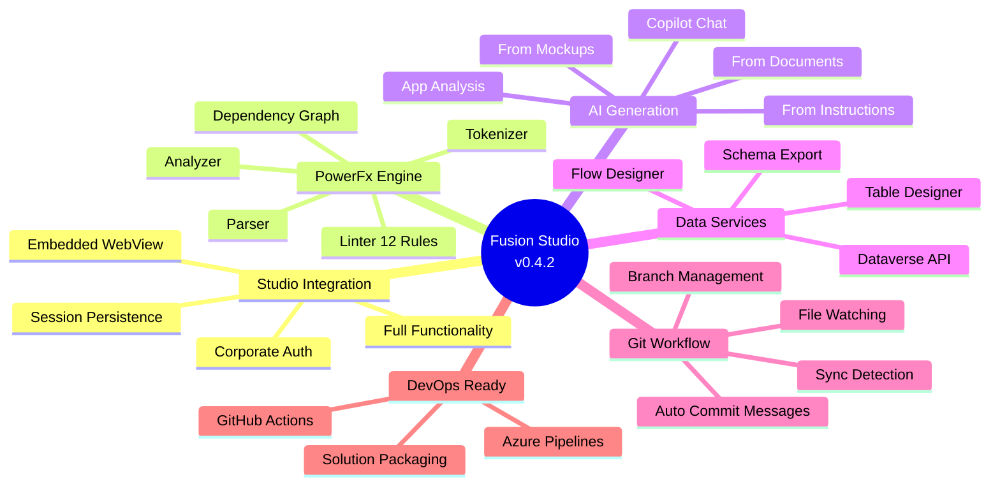

---

## 1. Power Apps Studio Integration

Embed the full Power Apps Studio experience directly in VS Code.

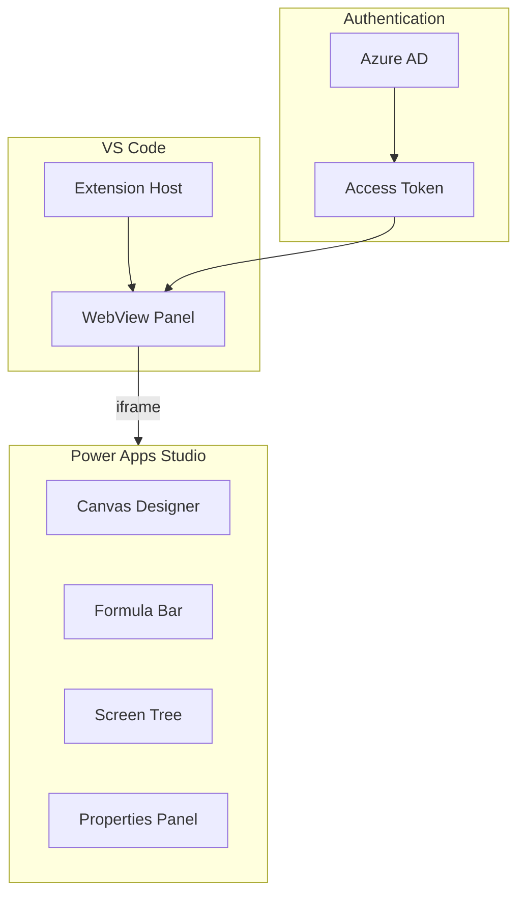

### Capabilities

| Feature | Description | Status |
|---------|-------------|--------|
| Full Designer | All studio tools available | ✅ |
| Formula Editing | IntelliSense and validation | ✅ |
| Control Palette | All controls available | ✅ |
| Data Sources | Connection management | ✅ |
| Real-time Preview | Live app preview | ✅ |
| Corporate Auth | SSO and MFA support | ✅ |

### Commands

```
Fusion Studio: Open Power Apps Studio       Ctrl+Shift+S
Fusion Studio: Refresh Studio
Fusion Studio: Toggle Studio DevTools
```

---

## 2. PowerFx Analysis Engine

Professional-grade analysis of PowerFx formulas.

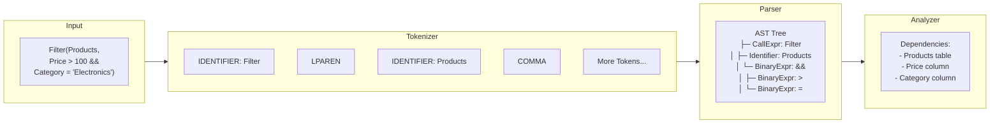

### Token Types

| Token | Example | Description |
|-------|---------|-------------|
| IDENTIFIER | `Products`, `Filter` | Names |
| NUMBER | `100`, `3.14` | Numeric literals |
| STRING | `"Hello"` | Text literals |
| OPERATOR | `+`, `-`, `&&`, `\|\|` | Operators |
| KEYWORD | `true`, `false`, `in` | Reserved words |
| PUNCTUATION | `(`, `)`, `,`, `.` | Delimiters |

### Lint Rules

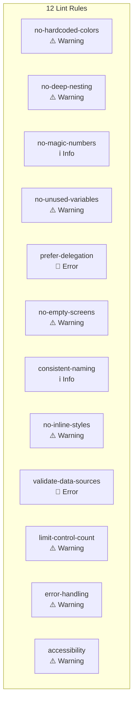

### Dependency Graph Export

Export formats for your app's data flow:

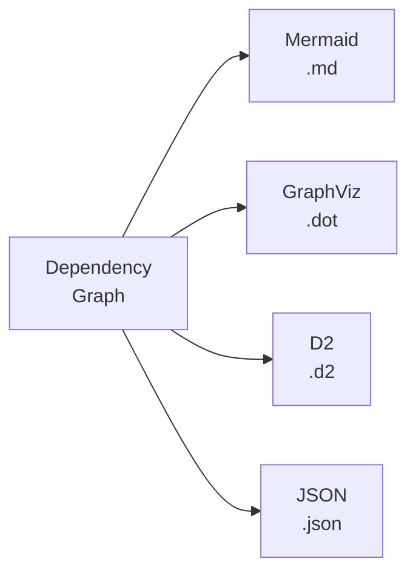

### Commands

```
Fusion Studio: Analyze PowerFx Formula
Fusion Studio: Lint Current File
Fusion Studio: Export Dependency Graph (Mermaid)
Fusion Studio: Export Dependency Graph (DOT)
Fusion Studio: Export Dependency Graph (D2)
Fusion Studio: Export Dependency Graph (JSON)
```

---

## 3. AI-Powered Generation

Generate apps, flows, and schemas using Azure OpenAI.

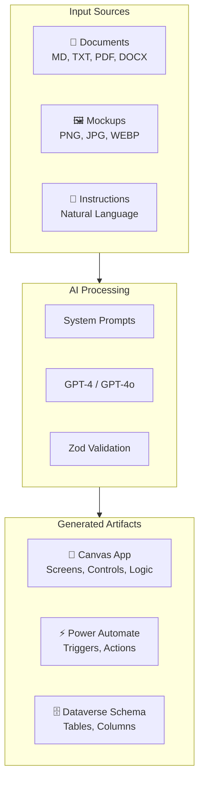

### Generation Types

#### From Documents

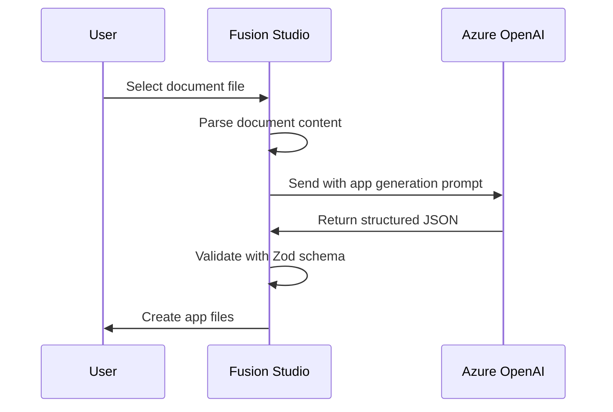

**Supported Formats:**
- Markdown (.md)
- Plain Text (.txt)
- PDF (.pdf)
- Word Documents (.docx)

#### From Mockups

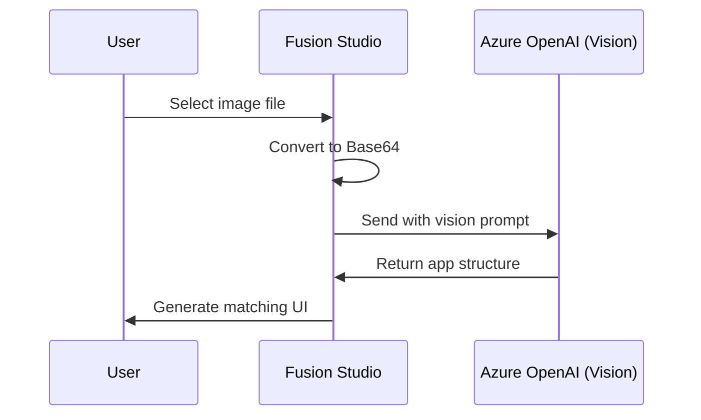

**Supported Formats:**
- PNG (.png)
- JPEG (.jpg, .jpeg)
- WebP (.webp)

#### From Instructions

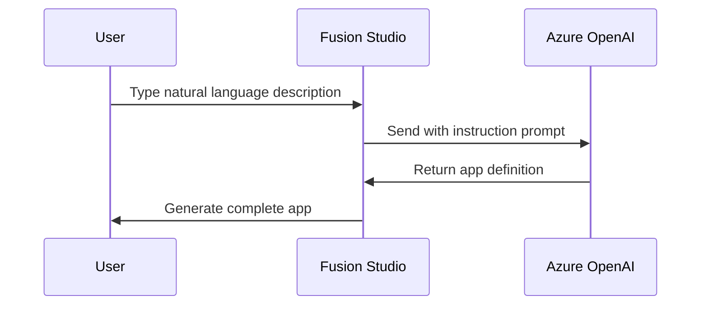

### AI Chat Copilot

Interactive assistant for Power Platform development:

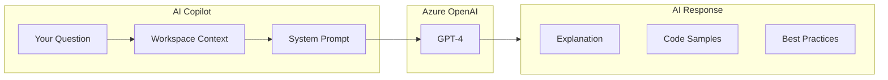

### Commands

```
Fusion Studio: Generate App from Document
Fusion Studio: Generate App from Mockup
Fusion Studio: Generate App from Instructions
Fusion Studio: Analyze Canvas App with AI
Fusion Studio: Open Copilot Sidebar          Ctrl+Shift+C
Fusion Studio: Set Azure OpenAI API Key
```

### Configuration

```json
{
  "fusionStudio.azureOpenAi.endpoint": "https://your-resource.openai.azure.com",
  "fusionStudio.azureOpenAi.deploymentName": "gpt-4",
  "fusionStudio.azureOpenAi.apiVersion": "2024-02-15-preview"
}
```

---

## 4. Dataverse Integration

Direct integration with Dataverse for data modeling.

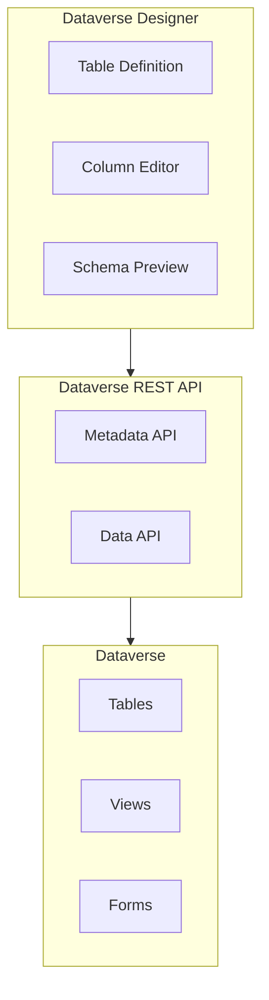

### Table Designer Features

| Feature | Description |
|---------|-------------|
| Visual Editor | Design tables with drag-and-drop |
| Column Types | All Dataverse column types supported |
| Validation | Real-time schema validation |
| Auto-naming | Smart schema name suggestions |
| Batch Create | Create table and all columns at once |

### Column Types

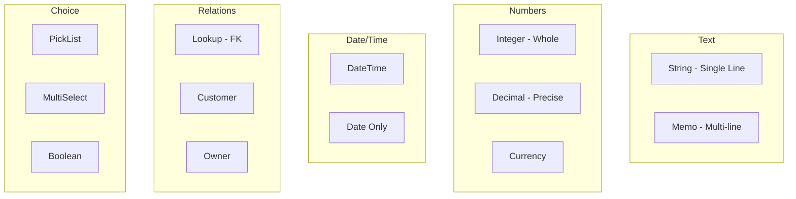

### Commands

```
Fusion Studio: Open Dataverse Designer
Fusion Studio: List Dataverse Tables
Fusion Studio: Create Dataverse Table
Fusion Studio: Reset Dataverse Client
```

---

## 5. Flow Designer

Generate Power Automate flows from natural language.

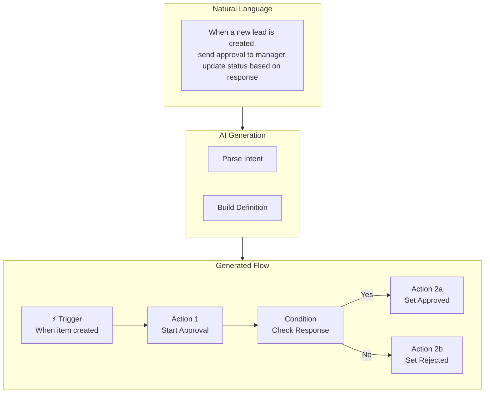

### Features

| Feature | Description |
|---------|-------------|
| Natural Language | Describe flows in plain English |
| Visual Preview | See execution map before deploying |
| JSON Export | Copy definition to Power Automate |
| Example Prompts | Quick-start templates |
| Stats Dashboard | Trigger/action/connector counts |

### Commands

```
Fusion Studio: Open Flow Designer
Fusion Studio: Generate Flow from Instructions
```

---

## 6. Git Integration

Professional Git workflow for Power Apps.

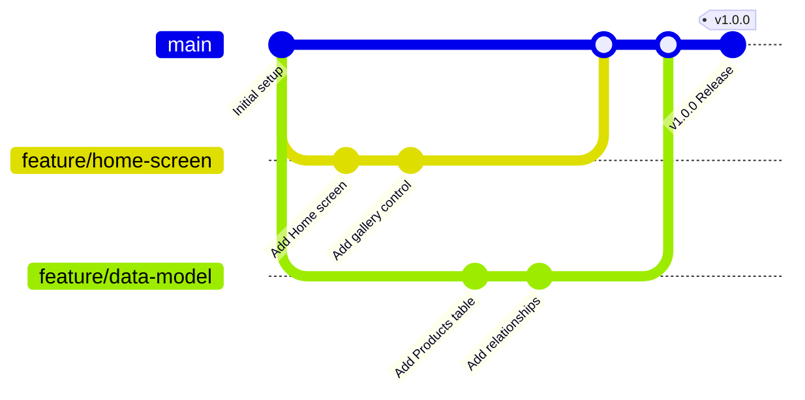

### Smart Commit Messages

Fusion Studio generates contextual commit messages:

```
[PowerApps] Screen: Added "Home" screen

- New screen with gallery control
- Connected to Products data source
- Added navigation logic

---

[PowerApps] Control: Updated "Gallery1" properties

- Changed template to custom
- Added selection indicator
- Improved performance
```

### File Watching

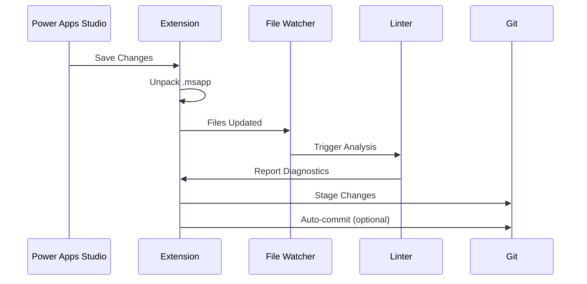

### Commands

```
Fusion Studio: Initialize Git Repository
Fusion Studio: Commit Changes
Fusion Studio: Commit Power Apps Changes
Fusion Studio: Create Feature Branch
Fusion Studio: Push Changes
Fusion Studio: Pull Changes
Fusion Studio: Sync Repository
Fusion Studio: Toggle File Watcher
```

---

## 7. DevOps Integration

CI/CD ready with GitHub Actions and Azure Pipelines.

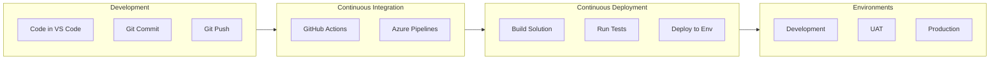

### Included Templates

| Template | Location | Purpose |
|----------|----------|---------|
| GitHub Actions | `templates/github-actions/` | GitHub CI/CD (copy to `.github/workflows/` in your app repo) |
| Azure Pipelines | `.azure-pipelines/` | Azure DevOps CI/CD |

### Pipeline Stages

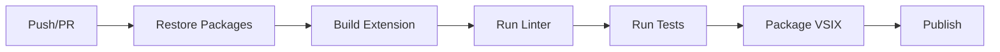

---

## 8. Observability & Logging

Monitor extension state and debug issues.

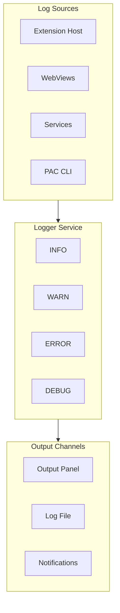

### Tree Views

| View | Purpose |
|------|---------|
| Environments | List and select Power Platform environments |
| Apps | Explore Canvas App structure |
| Dependencies | View data sources and variables |
| Observability | Monitor live studio state |

### Debug Mode

Enable verbose logging:

```json
{
  "fusionStudio.debug": true,
  "fusionStudio.logLevel": "debug"
}
```

---

## Complete Command Reference

### Studio Commands

| Command | Description | Shortcut |
|---------|-------------|----------|
| `openStudio` | Open Power Apps Studio | `Ctrl+Shift+S` |
| `openDashboard` | Open Fusion Studio Dashboard | `Ctrl+Shift+D` |

### Analysis Commands

| Command | Description |
|---------|-------------|
| `analyzeFormula` | Analyze selected PowerFx |
| `lintFormula` | Run linter on current file |
| `exportDependencyGraph` | Export as Mermaid |
| `exportDependencyDot` | Export as DOT |
| `exportDependencyD2` | Export as D2 |
| `exportDependencyJson` | Export as JSON |

### AI Commands

| Command | Description | Shortcut |
|---------|-------------|----------|
| `generateFromDocument` | Generate from document | |
| `generateFromMockup` | Generate from image | |
| `generateFromInstructions` | Generate from text | |
| `analyzeCanvasApp` | AI analysis of app | |
| `openChatPanel` | Open AI Copilot | `Ctrl+Shift+C` |
| `setApiKey` | Set Azure OpenAI key | |

### Dataverse Commands

| Command | Description |
|---------|-------------|
| `openDataverseDesigner` | Open table designer |
| `listTables` | List Dataverse tables |
| `createTable` | Create new table |
| `resetDataverseClient` | Reset API client |

### Git Commands

| Command | Description |
|---------|-------------|
| `gitInit` | Initialize repository |
| `gitCommit` | Commit changes |
| `gitCommitPowerApps` | Commit with PA message |
| `gitCreateBranch` | Create feature branch |
| `gitPush` | Push to remote |
| `gitPull` | Pull from remote |
| `gitSync` | Sync with remote |

### PAC Commands

| Command | Description |
|---------|-------------|
| `unpackApp` | Unpack .msapp file |
| `packApp` | Pack to .msapp file |
| `selectEnvironment` | Select environment |
| `authStatus` | Check auth status |
| `refreshEnvironments` | Refresh env list |
| `refreshApps` | Refresh app list |

---

## Configuration Reference

All settings are in the `fusionStudio.*` namespace:

```json
{
  // Azure OpenAI
  "fusionStudio.azureOpenAi.endpoint": "",
  "fusionStudio.azureOpenAi.deploymentName": "gpt-4",
  "fusionStudio.azureOpenAi.apiVersion": "2024-02-15-preview",
  
  // Debugging
  "fusionStudio.debug": false,
  "fusionStudio.logLevel": "info",
  
  // File Watching
  "fusionStudio.autoWatch": true,
  "fusionStudio.watchDebounce": 500,
  
  // Git
  "fusionStudio.autoCommit": false,
  "fusionStudio.commitMessageFormat": "[PowerApps] {type}: {description}"
}
```

---

*Fusion Studio v0.4.2 - Complete Feature Reference*
