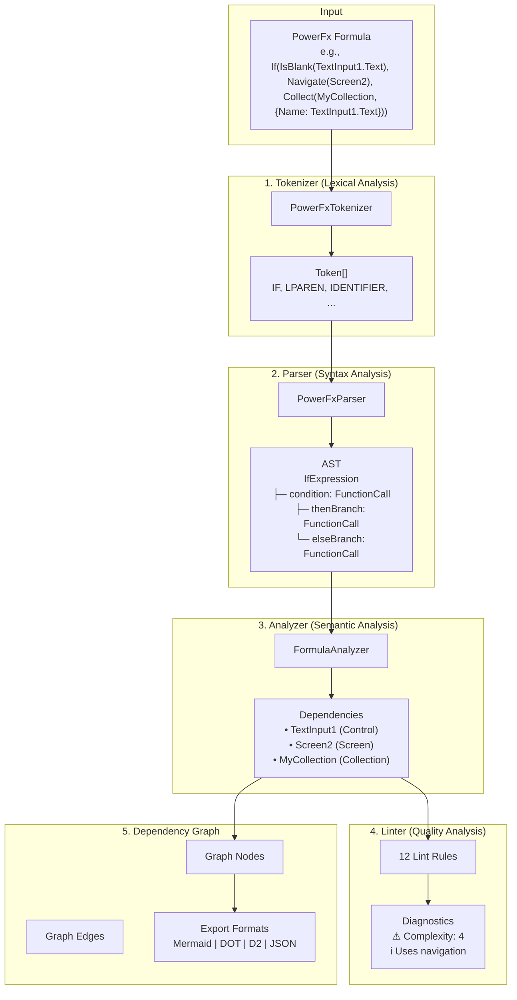
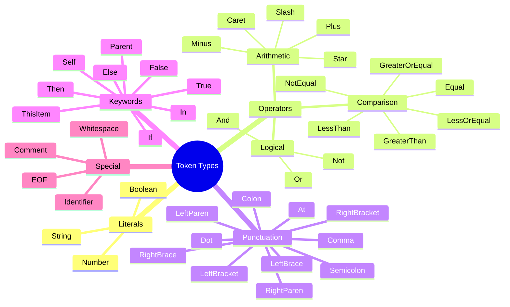
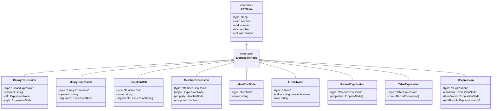
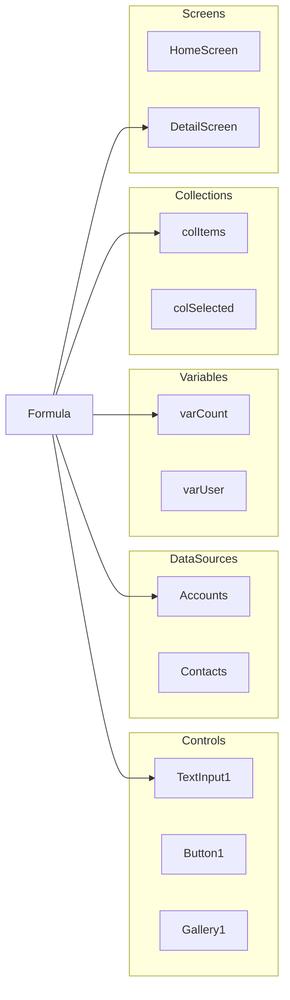
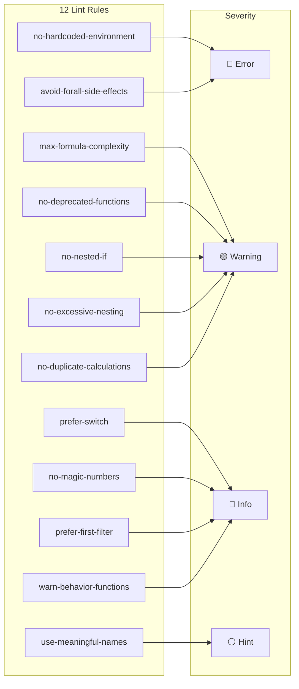
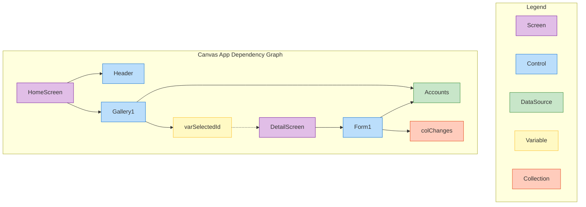
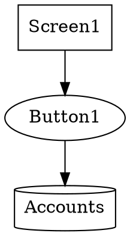
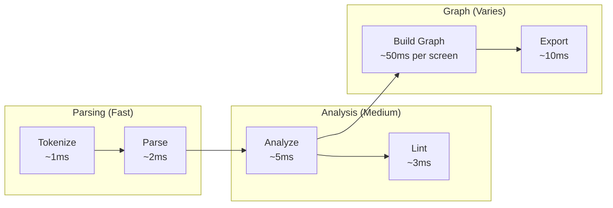

# PowerFx Analysis Engine

## Overview

The PowerFx Analysis Engine provides comprehensive static analysis of PowerFx formulas used in Canvas Apps. It consists of four main components working together in a pipeline.

## Analysis Pipeline



## Token Types

The tokenizer recognizes 40+ token types:



## AST Node Types



## Dependency Types



## Linter Rules



### Rule Details

| Rule | Severity | Description |
|------|----------|-------------|
| `max-formula-complexity` | Warning | Formula exceeds complexity threshold (default: 10) |
| `no-hardcoded-environment` | Error | Environment URLs should use config, not literals |
| `no-deprecated-functions` | Warning | Using deprecated PowerFx functions |
| `prefer-switch` | Info | Multiple If/ElseIf should use Switch |
| `no-nested-if` | Warning | Deeply nested If statements (>3 levels) |
| `avoid-forall-side-effects` | Error | ForAll with Patch/Collect/Set is risky |
| `no-magic-numbers` | Info | Numeric literals should be named constants |
| `use-meaningful-names` | Hint | Variable names should be descriptive |
| `no-excessive-nesting` | Warning | Expression nesting exceeds limit |
| `prefer-first-filter` | Info | Use First(Filter(...)) instead of LookUp |
| `no-duplicate-calculations` | Warning | Same expression calculated multiple times |
| `warn-behavior-functions` | Info | Uses behavior functions (Navigate, Collect, etc.) |

## Dependency Graph

### Graph Structure



### Export Formats

#### Mermaid
```
graph TD
  Screen1["Screen1"]
  Screen1 --> Button1
  Button1 --> Accounts["Accounts (DataSource)"]
```

#### DOT (Graphviz)


#### D2
```d2
Screen1: Screen1 {
  shape: rectangle
}
Button1: Button1
Accounts: Accounts {
  shape: cylinder
}
Screen1 -> Button1
Button1 -> Accounts
```

#### JSON
```json
{
  "nodes": [
    {"id": "Screen1", "type": "screen"},
    {"id": "Button1", "type": "control"},
    {"id": "Accounts", "type": "datasource"}
  ],
  "edges": [
    {"from": "Screen1", "to": "Button1"},
    {"from": "Button1", "to": "Accounts"}
  ]
}
```

## Usage Examples

### Basic Linting

```typescript
import { lintFormula } from './powerfx/linter';

const formula = `If(IsBlank(TextInput1.Text), "Empty", TextInput1.Text)`;
const diagnostics = lintFormula(formula);

// diagnostics: [{
//   message: "Formula complexity: 2",
//   severity: "info",
//   line: 1, column: 1
// }]
```

### Building Dependency Graph

```typescript
import { createDependencyGraph } from './powerfx/dependencyGraph';

const graph = createDependencyGraph();
await graph.buildFromSource('./src/unpacked-app');

// Get statistics
const stats = graph.getStats();
// { totalNodes: 45, totalEdges: 67, screens: 5, dataSources: 3, ... }

// Export to Mermaid
const mermaid = graph.exportToMermaid();
// "graph TD\n  HomeScreen --> ..."

// Find circular dependencies
const circular = stats.circularDependencies;
// [["Control1", "Control2", "Control1"], ...]
```

### Formula Analysis

```typescript
import { analyzeFormula } from './powerfx';

const analysis = analyzeFormula(`
  Collect(MyData, 
    { Name: TextInput1.Text, 
      Date: Today() 
    }
  )
`);

// analysis: {
//   complexity: 3,
//   dependencies: [
//     { type: "collection", name: "MyData", isWrite: true },
//     { type: "control", name: "TextInput1", isWrite: false }
//   ],
//   functionCalls: [
//     { name: "Collect", isBehavior: true },
//     { name: "Today", isBehavior: false }
//   ],
//   hasImperativeCode: true
// }
```

## Performance Considerations



- **Tokenization**: O(n) where n = formula length
- **Parsing**: O(n) with recursive descent
- **Analysis**: O(n) single pass with visitor pattern
- **Linting**: O(n) per rule, parallelizable
- **Graph Building**: O(files) where files = unpacked app files
