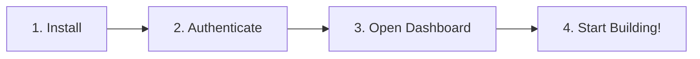
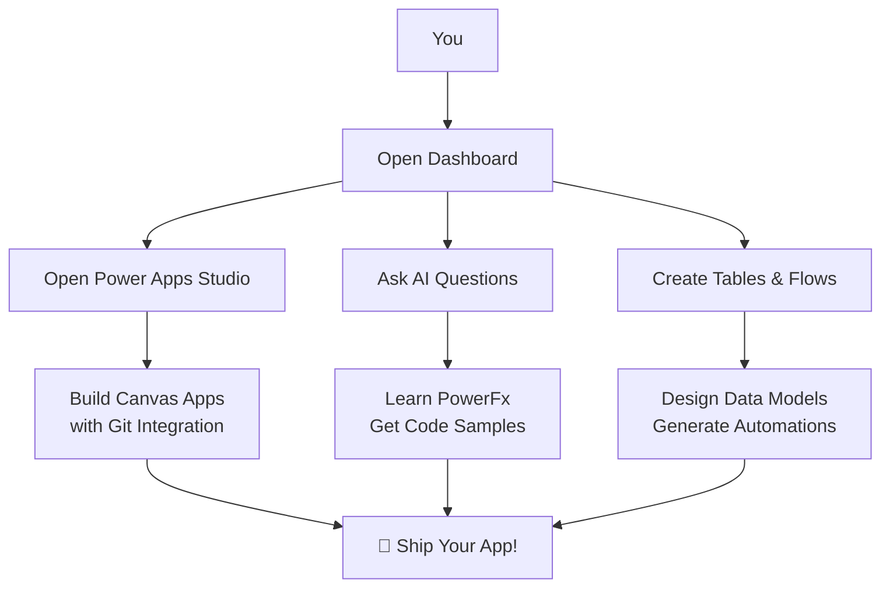

# Fusion Studio - Quick Start Guide

> **Get up and running in 5 minutes**

---

## 🚀 Quick Start



---

## Step 1: Install

### Prerequisites
- ✅ VS Code 1.85+
- ✅ Node.js 18+
- ✅ Power Platform CLI (PAC)

### Install Extension
```
1. Open VS Code
2. Press Ctrl+Shift+X (Extensions)
3. Search "Power Apps Fusion Studio"
4. Click Install
```

---

## Step 2: Authenticate with Power Platform

```powershell
# Open terminal and run:
pac auth create --environment https://your-org.crm.dynamics.com
```

A browser window will open - sign in with your Power Platform credentials.

---

## Step 3: Open Dashboard

```
Press Ctrl+Shift+P → Type "Open Dashboard" → Press Enter
```

Or: The Dashboard opens automatically on first activation!

---

## Step 4: Start Building!

### Quick Actions from Dashboard

| Button | What it Does |
|--------|--------------|
| **Open Studio** | Launch Power Apps Studio in VS Code |
| **AI Chat** | Open AI Copilot for questions |
| **New App** | Generate a new Canvas App |
| **Design Table** | Create Dataverse tables visually |

---

## 🎯 Common Tasks

### Ask AI for Help
```
Ctrl+Shift+C → Type your question → Press Enter
```

**Example questions:**
- "How do I filter a gallery by current user?"
- "Design a Dataverse schema for project management"
- "Create an approval flow for purchase requests"

### Analyze Your PowerFx
```
1. Select PowerFx formula in editor
2. Ctrl+Shift+P → "Analyze PowerFx"
3. View results in Problems panel
```

### Create a Dataverse Table
```
1. Dashboard → "Design Tables"
2. Fill in table details
3. Add columns
4. Click "Create Table"
```

### Generate a Flow
```
1. Dashboard → Flow Designer card
2. Describe your flow in plain English
3. Click "Generate Flow"
4. Copy JSON to Power Automate
```

---

## ⚙️ Optional: Configure AI Features

For AI generation features, configure Azure OpenAI:

### 1. Add Settings
```json
// File > Preferences > Settings (JSON)
{
  "fusionStudio.azureOpenAi.endpoint": "https://YOUR-RESOURCE.openai.azure.com",
  "fusionStudio.azureOpenAi.deploymentName": "gpt-4"
}
```

### 2. Set API Key
```
Ctrl+Shift+P → "Set Azure OpenAI API Key" → Paste your key
```

---

## 📚 Next Steps

| Want to... | Read this... |
|------------|--------------|
| Learn all features | [User Guide](USER-GUIDE.md) |
| See all commands | [Features Reference](FEATURES.md) |
| Fix a problem | [Troubleshooting](TROUBLESHOOTING.md) |
| Understand the code | [Architecture](ARCHITECTURE.md) |

---

## ❓ Need Help?

1. **Check the docs**: [docs/](.)
2. **Search issues**: [GitHub Issues](https://github.com/devladlog/Fusion-Studio/issues)
3. **Ask questions**: [Open an issue](https://github.com/devladlog/Fusion-Studio/issues/new/choose)

---

## 🎉 You're Ready!



---

*Happy building with Fusion Studio! 🎨*
