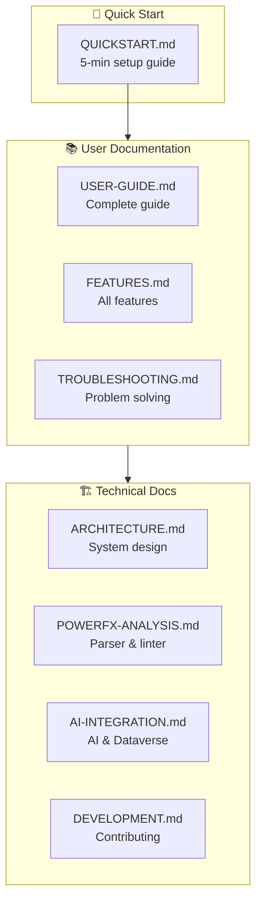
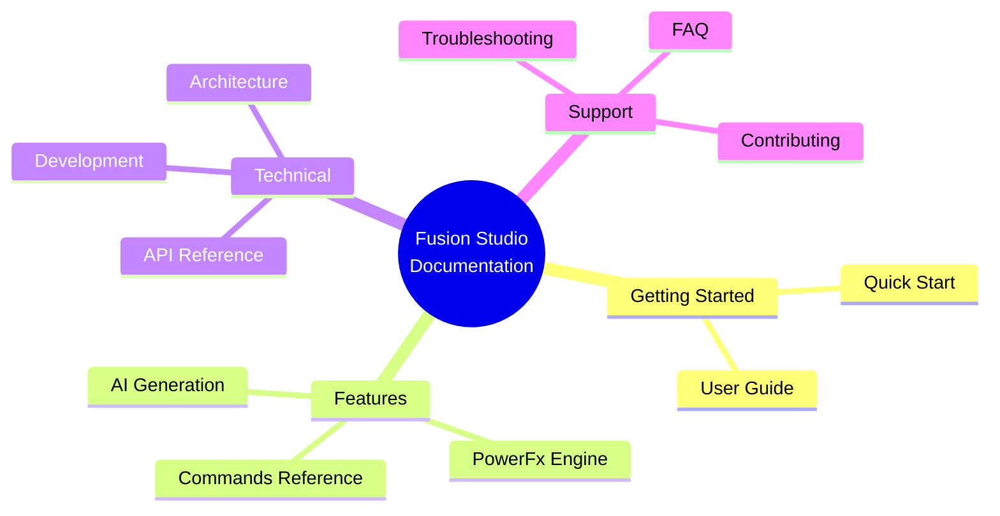

# Fusion Studio Documentation

> **Complete documentation index for Fusion Studio**

---

---

## 📖 Documentation Index

### Getting Started

| Document | Description | Audience |
|----------|-------------|----------|
| [🚀 Quick Start](QUICKSTART.md) | Get up and running in 5 minutes | Everyone |
| [📖 User Guide](USER-GUIDE.md) | Complete guide with tutorials | Users |

### Feature Documentation

| Document | Description | Audience |
|----------|-------------|----------|
| [🎯 Features](FEATURES.md) | All commands and capabilities | Users |
| [⚡ PowerFx Analysis](POWERFX-ANALYSIS.md) | Tokenizer, parser, linter | Users/Devs |
| [🤖 AI Integration](AI-INTEGRATION.md) | Azure OpenAI & Dataverse | Users/Admins |

### Technical Documentation

| Document | Description | Audience |
|----------|-------------|----------|
| [🏛️ Architecture](ARCHITECTURE.md) | System design, components | Developers |
| [👨‍💻 Development](DEVELOPMENT.md) | Setup, testing, contributing | Developers |
| [🔧 Troubleshooting](TROUBLESHOOTING.md) | Common issues & solutions | Everyone |

---

## 📊 Document Map

---

## 🎯 Find What You Need

### "I want to..."

| Goal | Read This |
|------|-----------|
| Install and start using | [Quick Start](QUICKSTART.md) |
| Learn all features | [User Guide](USER-GUIDE.md) |
| Find a specific command | [Features](FEATURES.md) |
| Configure AI features | [AI Integration](AI-INTEGRATION.md) |
| Understand PowerFx analysis | [PowerFx Analysis](POWERFX-ANALYSIS.md) |
| Fix an error | [Troubleshooting](TROUBLESHOOTING.md) |
| Understand the code | [Architecture](ARCHITECTURE.md) |
| Contribute to the project | [Development](DEVELOPMENT.md) |

---

## 📁 Diagrams

Mermaid diagrams are embedded inline in each document, including:

- Architecture diagrams
- Data flow diagrams
- State diagrams
- Sequence diagrams

---

## 🔗 External Resources

| Resource | Link |
|----------|------|
| GitHub Repository | [github.com/devladlog/Fusion-Studio](https://github.com/devladlog/Fusion-Studio) |
| Power Platform Docs | [docs.microsoft.com/power-platform](https://docs.microsoft.com/power-platform) |
| PowerFx Reference | [docs.microsoft.com/power-platform/power-fx](https://docs.microsoft.com/power-platform/power-fx) |
| Azure OpenAI | [learn.microsoft.com/azure/ai-services/openai](https://learn.microsoft.com/azure/ai-services/openai) |

---

## 📝 Documentation Guidelines

When contributing documentation:

1. **Use Mermaid diagrams** for visual explanations
2. **Include code examples** where applicable
3. **Keep tables** for quick reference
4. **Add troubleshooting** sections
5. **Link to related docs**

---

*Fusion Studio v0.4.2 Documentation*
