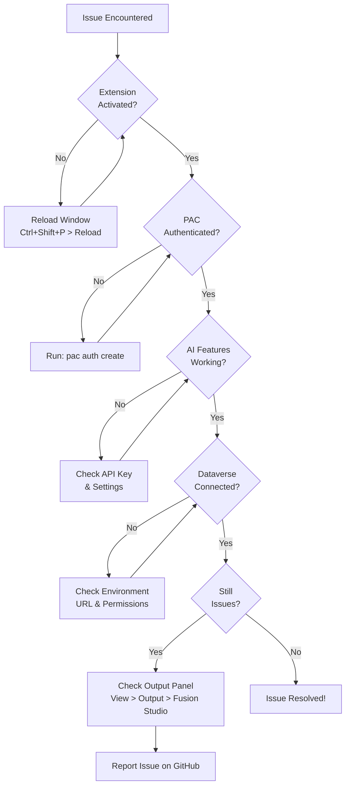
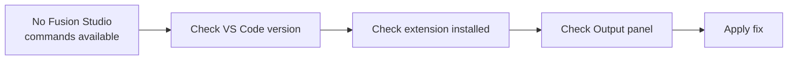
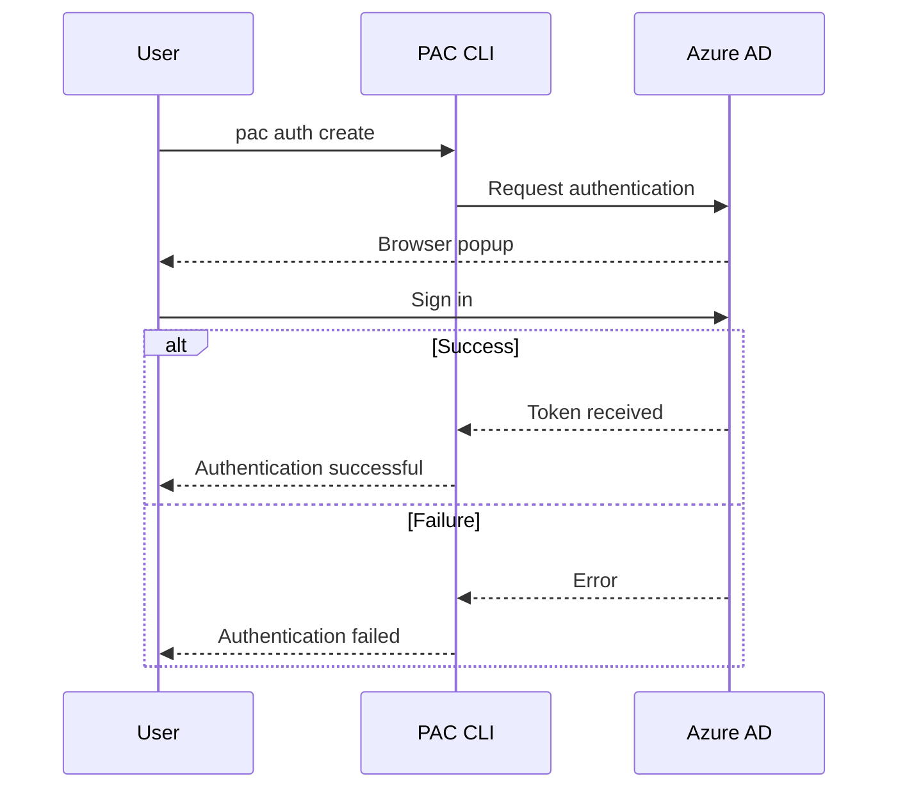
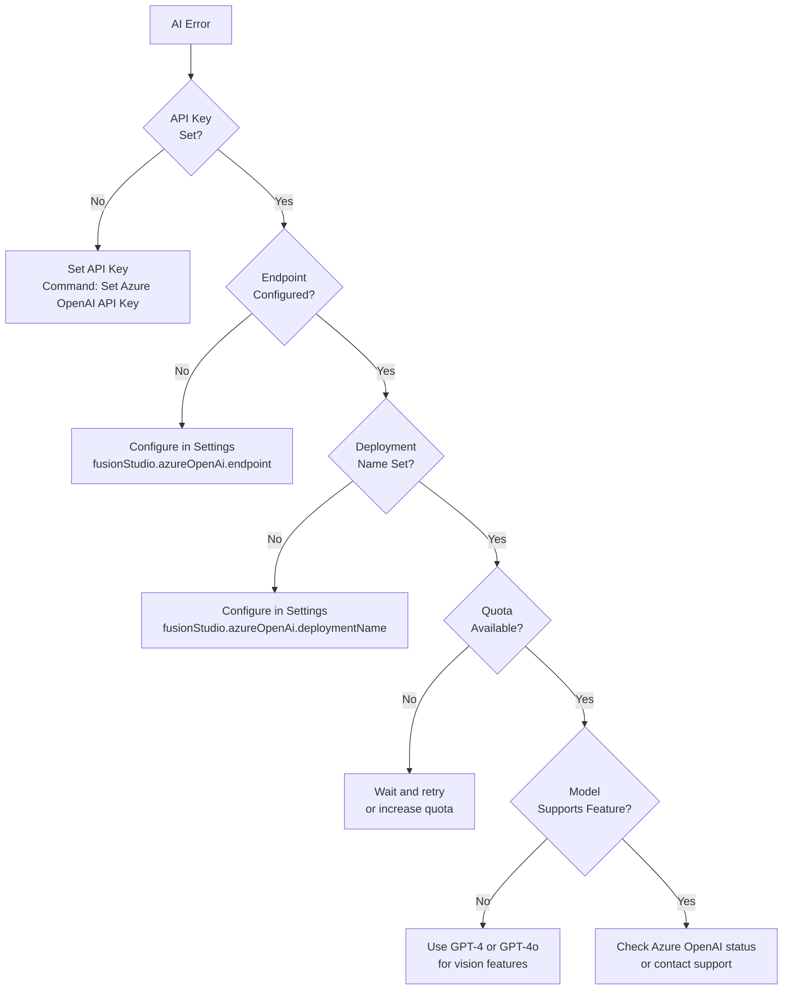
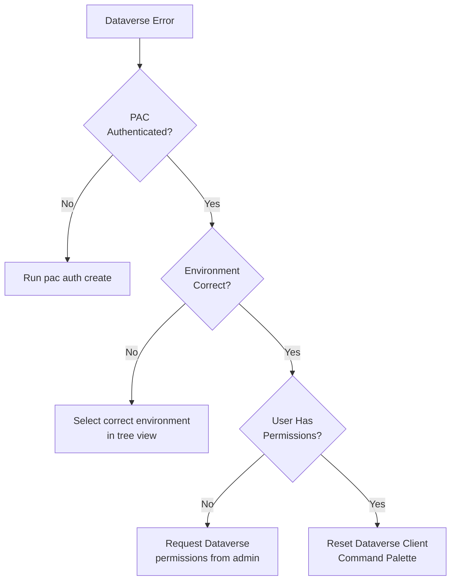
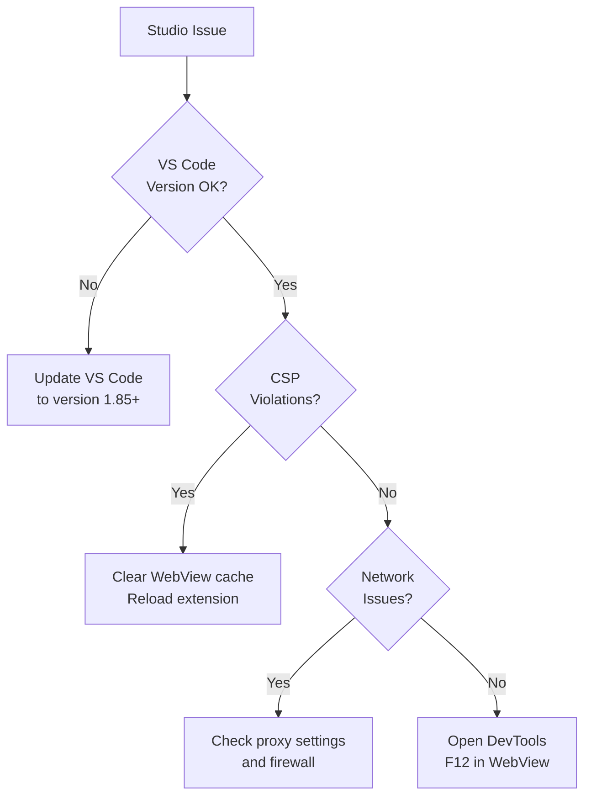
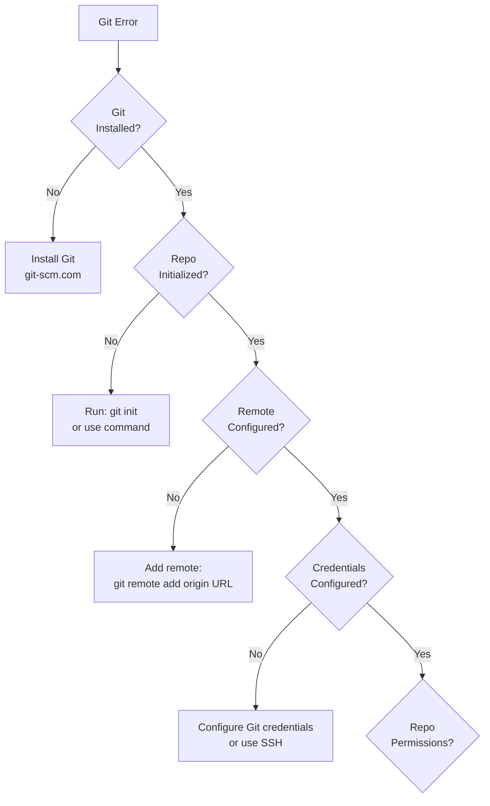
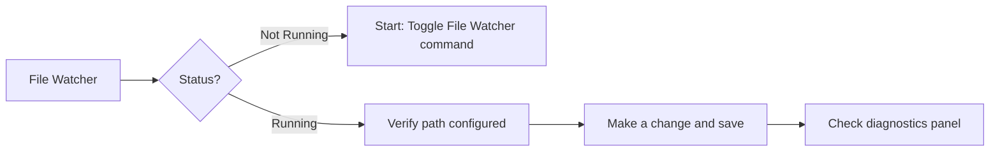
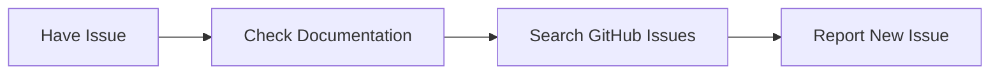
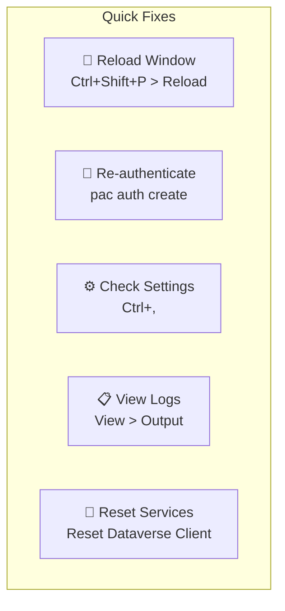

# Fusion Studio - Troubleshooting Guide

> **Solutions to common issues and how to get help**

---

## Quick Diagnostics



---

## Common Issues

### 1. Extension Not Activating



**Symptoms:**
- Commands not appearing in palette
- No Fusion Studio tree views
- Dashboard doesn't open

**Solutions:**

| Step | Action |
|------|--------|
| 1 | Verify VS Code version is 1.85+ |
| 2 | Reload window: `Ctrl+Shift+P` > "Reload Window" |
| 3 | Check Output panel for errors: View > Output > Fusion Studio |
| 4 | Reinstall extension if needed |
| 5 | Check for conflicting extensions |

**Quick Fix:**
```
1. Press Ctrl+Shift+P
2. Type "Reload Window"
3. Press Enter
```

---

### 2. PAC Authentication Failed



**Symptoms:**
- "Not authenticated" errors
- Environment list empty
- Studio won't load

**Solutions:**

```powershell
# Step 1: Clear existing auth
pac auth clear

# Step 2: Create new auth
pac auth create --environment https://your-org.crm.dynamics.com

# Step 3: Verify
pac auth list
```

**Common Causes:**

| Cause | Solution |
|-------|----------|
| Expired token | Run `pac auth create` again |
| Wrong environment | Use correct environment URL |
| MFA required | Complete MFA in browser |
| Firewall blocking | Check corporate firewall settings |
| VPN issues | Connect to VPN or whitelist URLs |

---

### 3. AI Features Not Working



**Symptoms:**
- "API key not configured" error
- "Request failed" errors
- Empty AI responses
- Mockup analysis fails

**Required Settings:**

```json
{
  "fusionStudio.azureOpenAi.endpoint": "https://YOUR-RESOURCE.openai.azure.com",
  "fusionStudio.azureOpenAi.deploymentName": "gpt-4",
  "fusionStudio.azureOpenAi.apiVersion": "2024-02-15-preview"
}
```

**Set API Key:**
```
1. Press Ctrl+Shift+P
2. Type "Set Azure OpenAI API Key"
3. Enter your API key when prompted
```

**Troubleshooting Checklist:**

| Check | How to Verify |
|-------|---------------|
| Endpoint URL | Must start with `https://` and end with `.openai.azure.com` |
| Deployment name | Must match your Azure OpenAI deployment |
| API key | 32-character key from Azure portal |
| Model capabilities | GPT-4 Vision for mockup analysis |
| Quota | Check Azure portal for usage limits |

---

### 4. Dataverse Connection Error



**Symptoms:**
- "Connection refused" errors
- Tables not loading
- "Permission denied" errors
- Create table fails

**Solutions:**

| Issue | Solution |
|-------|----------|
| Connection refused | Check VPN/firewall, verify URL |
| Permission denied | Request System Administrator or Customizer role |
| Token expired | Re-authenticate with PAC CLI |
| Wrong environment | Select correct environment in tree view |

**Reset Client:**
```
1. Press Ctrl+Shift+P
2. Type "Reset Dataverse Client"
3. Try operation again
```

---

### 5. Studio WebView Issues



**Symptoms:**
- Blank WebView panel
- Studio not loading
- Controls not rendering
- Session keeps resetting

**Solutions:**

1. **Reload WebView:**
   ```
   Right-click on WebView panel > Reload WebView
   ```

2. **Check Developer Tools:**
   ```
   Right-click on WebView > Open Developer Tools
   Look for errors in Console tab
   ```

3. **Clear Cache:**
   ```
   Ctrl+Shift+P > "Developer: Reload Window"
   ```

4. **Check Network:**
   - Ensure access to `*.powerapps.com`
   - Ensure access to `*.dynamics.com`
   - Check proxy settings in VS Code

---

### 6. Git Integration Issues



**Symptoms:**
- "Git not found" error
- Push/pull fails
- Commit messages not generated
- File watcher not detecting changes

**Solutions:**

| Issue | Solution |
|-------|----------|
| Git not found | Install Git and add to PATH |
| Not a repository | Run `git init` in workspace |
| No remote | Add remote with `git remote add origin URL` |
| Authentication | Configure SSH key or credential manager |
| Permission denied | Check repository access rights |

---

### 7. File Watcher Issues



**Symptoms:**
- Changes not detected
- Lint results not updating
- Sync notifications missing

**Solutions:**

1. **Check Watcher Status:**
   - Look at status bar for watcher indicator
   - Run "Toggle File Watcher" command

2. **Verify Configuration:**
   ```json
   {
     "fusionStudio.autoWatch": true,
     "fusionStudio.watchDebounce": 500
   }
   ```

3. **System Limits (Linux/Mac):**
   ```bash
   # Increase file watcher limit
   echo fs.inotify.max_user_watches=524288 | sudo tee -a /etc/sysctl.conf
   sudo sysctl -p
   ```

---

## Error Codes Reference

| Code | Description | Solution |
|------|-------------|----------|
| `PAC_AUTH_001` | Not authenticated | Run `pac auth create` |
| `PAC_AUTH_002` | Token expired | Re-authenticate |
| `PAC_ENV_001` | Environment not found | Check environment URL |
| `PAC_ENV_002` | Environment access denied | Request access from admin |
| `DV_CONN_001` | Connection refused | Check firewall/VPN |
| `DV_CONN_002` | Connection timeout | Check network, retry |
| `DV_PERM_001` | Permission denied | Request Dataverse role |
| `DV_SCHEMA_001` | Invalid schema | Check table/column names |
| `AI_KEY_001` | API key not set | Set API key via command |
| `AI_KEY_002` | Invalid API key | Verify key in Azure portal |
| `AI_ENDPOINT_001` | Endpoint not configured | Set endpoint in settings |
| `AI_ENDPOINT_002` | Endpoint unreachable | Check URL and network |
| `AI_QUOTA_001` | Rate limited | Wait and retry |
| `AI_QUOTA_002` | Quota exceeded | Increase quota in Azure |
| `AI_MODEL_001` | Model not found | Check deployment name |
| `GIT_NOT_FOUND` | Git not installed | Install Git |
| `GIT_NO_REPO` | Not a git repository | Run `git init` |
| `GIT_AUTH_001` | Authentication failed | Configure credentials |

---

## Debug Mode

Enable verbose logging to diagnose issues:

```json
// settings.json
{
  "fusionStudio.debug": true,
  "fusionStudio.logLevel": "debug"
}
```

### Viewing Logs

1. Open Output panel: View > Output
2. Select "Fusion Studio" from dropdown
3. Review log messages

### Log Levels

| Level | Description |
|-------|-------------|
| `error` | Only errors |
| `warn` | Errors and warnings |
| `info` | Normal operation messages |
| `debug` | Verbose debugging information |

---

## Getting Help

### Self-Service Resources



1. **Documentation:**
   - [USER-GUIDE.md](USER-GUIDE.md) - Complete user guide
   - [FEATURES.md](FEATURES.md) - Feature reference
   - [ARCHITECTURE.md](ARCHITECTURE.md) - Technical details

2. **GitHub Issues:**
   - Search existing issues: [Issues](https://github.com/devladlog/Fusion-Studio/issues)
   - Check closed issues for solutions

3. **Questions:**
   - Open an issue: [New issue](https://github.com/devladlog/Fusion-Studio/issues/new/choose)

### Reporting Issues

When reporting an issue, include:

```markdown
**Environment:**
- VS Code Version: 
- Extension Version: 
- OS: 
- PAC CLI Version: 

**Problem:**
[Description of the issue]

**Steps to Reproduce:**
1. 
2. 
3. 

**Expected Behavior:**
[What should happen]

**Actual Behavior:**
[What actually happens]

**Logs:**
[Paste relevant logs from Output panel]

**Screenshots:**
[If applicable]
```

### Collecting Diagnostic Info

```powershell
# Get VS Code version
code --version

# Get PAC CLI version
pac --version

# Get extension version
# Found in Extensions panel > Fusion Studio > Details
```

---

## Quick Fixes Summary



| Issue | Quick Fix |
|-------|-----------|
| Extension not working | Reload Window |
| Auth issues | `pac auth create` |
| AI not working | Check API key and settings |
| Dataverse errors | Reset Dataverse Client |
| Studio blank | Reload WebView |
| Git errors | Verify Git installation |
| File watcher | Toggle File Watcher |

---

*Fusion Studio v0.4.2 - Troubleshooting Guide*
