# Fusion Studio - Complete User Guide

> **Your comprehensive guide to mastering Fusion Studio - Power Apps development with engineering superpowers**

---

## Table of Contents

1. [Getting Started](#getting-started)
2. [Dashboard Overview](#dashboard-overview)
3. [AI Copilot Chat](#ai-copilot-chat)
4. [Dataverse Designer](#dataverse-designer)
5. [Flow Designer](#flow-designer)
6. [PowerFx Analysis](#powerfx-analysis)
7. [Git Integration](#git-integration)
8. [Keyboard Shortcuts](#keyboard-shortcuts)
9. [Troubleshooting](#troubleshooting)

---

## Getting Started

### Prerequisites

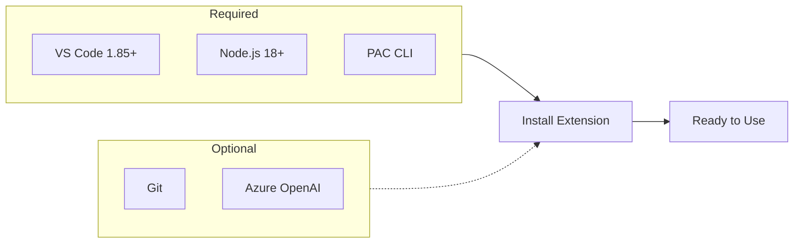

| Requirement | Version | Purpose |
|-------------|---------|---------|
| VS Code | 1.85+ | Extension host |
| Node.js | 18+ | Build tools |
| PAC CLI | Latest | Power Platform commands |
| Git | Any | Version control |
| Azure OpenAI | GPT-4/4o | AI generation features |

### Installation Steps

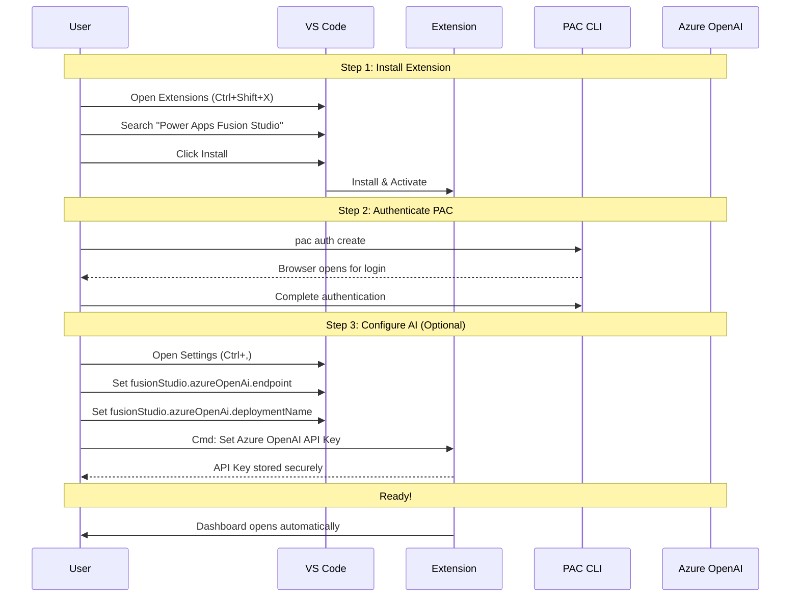

### First Launch

When you first open a workspace with Fusion Studio installed, the **Dashboard** opens automatically, giving you an overview of all features.

```
1. Press F1 or Ctrl+Shift+P
2. Type "Fusion Studio: Open Dashboard"
3. Press Enter
```

---

## Dashboard Overview

The Dashboard is your central hub for all Fusion Studio features.

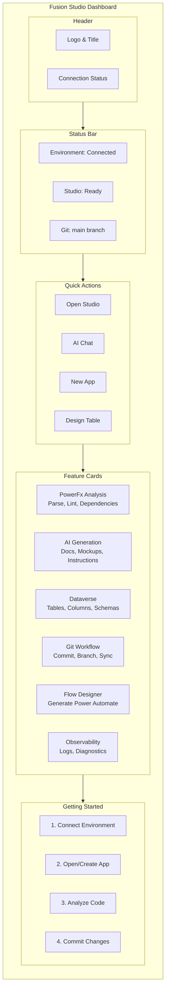

### Status Indicators

| Icon | Status | Meaning |
|------|--------|---------|
| 🟢 | Connected | Environment is connected |
| 🟡 | Pending | Connecting or loading |
| 🔴 | Disconnected | Not authenticated |
| ⚡ | Active | Operation in progress |

### Quick Actions

| Button | Action | Shortcut |
|--------|--------|----------|
| Open Studio | Launch Power Apps Studio | `Ctrl+Shift+S` |
| AI Chat | Open Copilot sidebar | `Ctrl+Shift+C` |
| New App | Create Canvas App | `Ctrl+Shift+N` |
| Design Table | Open Dataverse Designer | - |

---

## AI Copilot Chat

The AI Copilot is your intelligent assistant for Power Platform development.

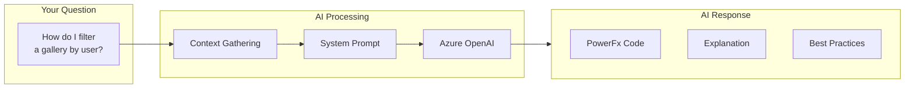

### How to Use

1. **Open AI Chat**
   - Click "AI Chat" in Dashboard, or
   - Press `Ctrl+Shift+C`, or
   - Command Palette: "Open Copilot Sidebar"

2. **Ask Questions**
   - Type your question in the input box
   - Press `Enter` to send
   - Use `Shift+Enter` for new lines

3. **Quick Suggestions**
   Click suggestion chips for common tasks:
   - Filter gallery by current user
   - Dataverse schema design
   - Approval flow creation

### Example Conversations

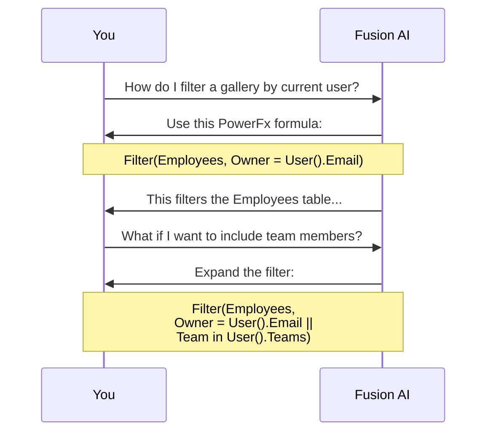

### Supported Topics

| Category | Example Questions |
|----------|-------------------|
| **PowerFx** | "How do filters work?", "Explain Patch function" |
| **Dataverse** | "Design a schema for...", "How to create relationships?" |
| **Flows** | "Create approval workflow", "Trigger on new record" |
| **Canvas Apps** | "Add navigation", "Responsive design tips" |
| **Best Practices** | "Error handling patterns", "Performance tips" |

---

## Dataverse Designer

Design production-ready Dataverse table schemas visually.

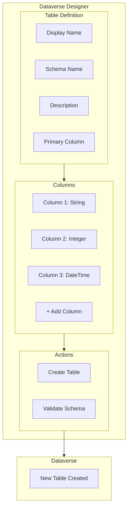

### Creating a Table

1. **Open Dataverse Designer**
   - From Dashboard: Click "Design Tables"
   - Command Palette: "Open Dataverse Designer"

2. **Define Table**
   ```
   Display Name: Project Task
   Schema Name: cr_projecttask
   Description: Stores project tasks and assignments
   Primary Column: name
   ```

3. **Add Columns**
   
   | Column | Type | Required |
   |--------|------|----------|
   | Task Name | String | Yes |
   | Due Date | DateTime | Yes |
   | Priority | PickList | No |
   | Assigned To | Lookup | No |
   | Completed | Boolean | No |

4. **Create Table**
   - Click "Create Table"
   - Wait for confirmation toast
   - Table is created in Dataverse!

### Column Types

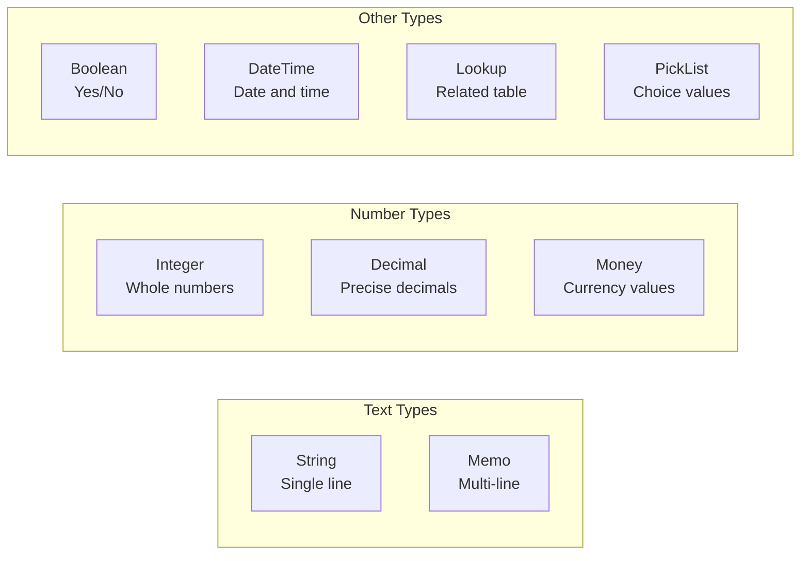

### Color Coding

Each column type has a color indicator for quick identification:

| Type | Color |
|------|-------|
| String | 🔵 Cyan |
| Memo | 🔵 Teal |
| Integer | 🟠 Orange |
| Decimal | 🟠 Light Orange |
| Money | 🟢 Green |
| Boolean | 🟣 Purple |
| DateTime | 🔵 Light Blue |
| Lookup | 🩷 Pink |
| PickList | 🟡 Yellow |

---

## Flow Designer

Generate Power Automate flows from natural language descriptions.

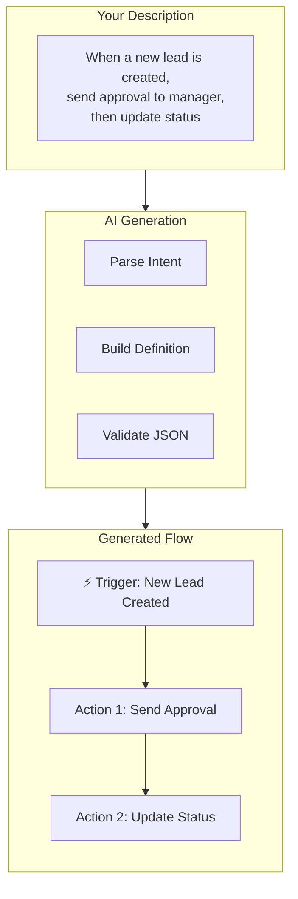

### Using Flow Designer

1. **Open Flow Designer**
   - Dashboard: Click on Flow Designer card
   - Command Palette: "Open Flow Designer"

2. **Write Description**
   ```
   Example: When a form is submitted, create a 
   Dataverse record, send confirmation email to 
   the submitter, and notify the admin in Teams.
   ```

3. **Generate Flow**
   - Click "Generate Flow"
   - Wait for AI processing
   - Review the generated flow

4. **Review Output**
   - **Summary**: Plain-language description
   - **Stats**: Trigger count, actions, connectors
   - **Execution Map**: Visual step-by-step flow
   - **Definition**: Raw JSON (copy to Power Automate)

### Example Prompts

| Use Case | Prompt |
|----------|--------|
| **Approval** | "When a purchase request exceeds $1000, send approval to finance manager" |
| **Notification** | "Daily at 8 AM, post overdue tasks to Teams channel" |
| **Integration** | "When email received from VIP list, create Dataverse record and notify sales" |
| **Data Sync** | "When SharePoint item modified, update corresponding Dataverse record" |

### Execution Map

The execution map shows your flow visually:

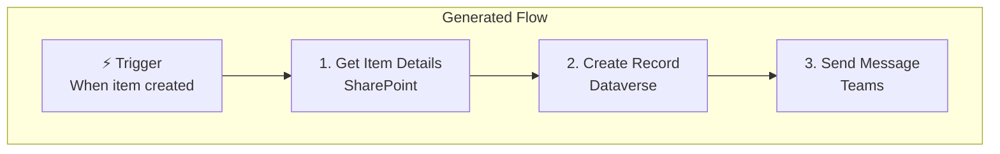

---

## PowerFx Analysis

Analyze your Canvas App formulas with the built-in PowerFx engine.

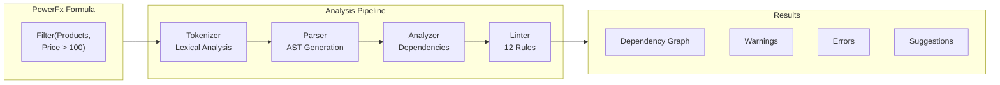

### Running Analysis

1. **Analyze Current Formula**
   - Select PowerFx code in editor
   - Command: "Analyze PowerFx"
   - View results in Problems panel

2. **Analyze Entire App**
   - Command: "Analyze Canvas App"
   - Reviews all screens and controls
   - Generates full dependency graph

### Lint Rules

The linter checks for 12 common issues:

| Rule | Description | Severity |
|------|-------------|----------|
| `no-hardcoded-colors` | Avoid hex colors, use themes | Warning |
| `no-deep-nesting` | Max 3 levels of nesting | Warning |
| `no-magic-numbers` | Extract to variables | Info |
| `no-unused-variables` | Remove dead code | Warning |
| `prefer-delegation` | Use delegable functions | Error |
| `no-empty-screens` | Screens need content | Warning |
| `consistent-naming` | Follow naming convention | Info |
| `no-inline-styles` | Use shared styles | Warning |
| `validate-data-sources` | Check connections | Error |
| `limit-control-count` | Max 500 per screen | Warning |
| `error-handling` | Add error boundaries | Warning |
| `accessibility` | WCAG compliance | Warning |

### Dependency Graph

Export your app's dependency graph in multiple formats:

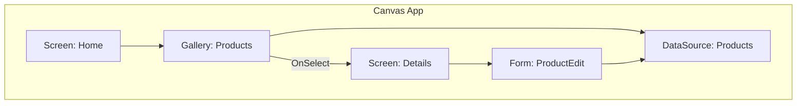

**Export Formats:**
- **Mermaid** - For documentation
- **DOT** - For Graphviz
- **D2** - For D2 diagrams
- **JSON** - For processing

---

## Git Integration

Professional Git workflow built into Fusion Studio.

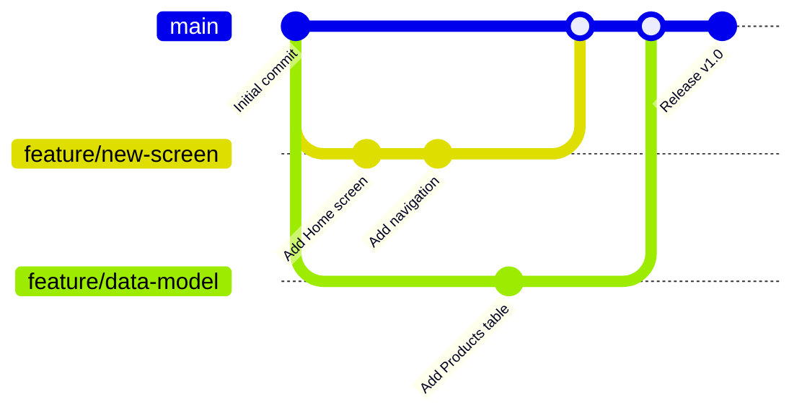

### Git Commands

| Command | Description | Shortcut |
|---------|-------------|----------|
| Initialize Repo | Create new Git repository | - |
| Commit Changes | Save with Power Apps message | `Ctrl+Shift+G` |
| Create Branch | New feature branch | - |
| Push | Upload to remote | - |
| Pull | Download changes | - |
| Sync | Push + Pull | - |

### Power Apps Commit Messages

Fusion Studio generates meaningful commit messages:

```
[PowerApps] Screen: Added "Home" screen

- New screen with gallery control
- Added navigation to Details
- Connected to Products data source
```

### Workflow

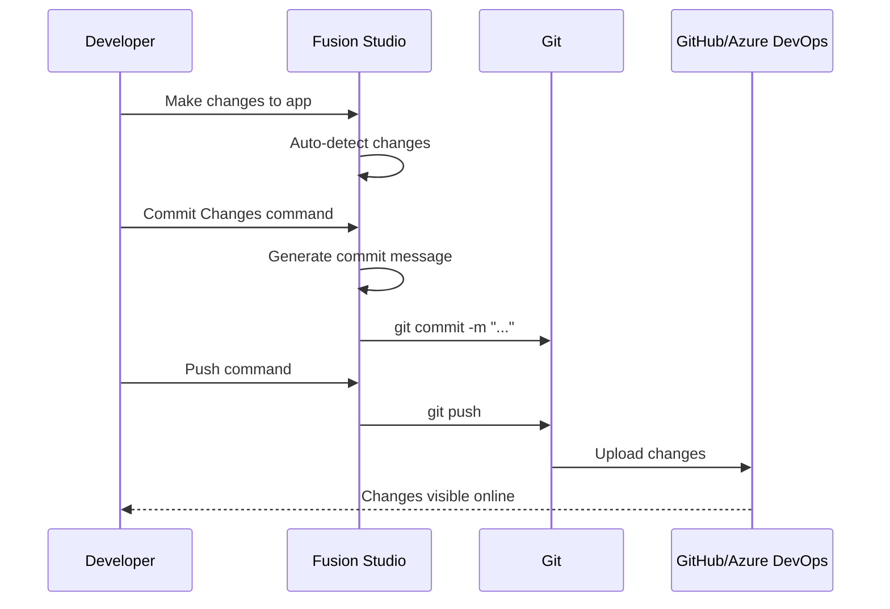

---

## Keyboard Shortcuts

### Global Shortcuts

| Shortcut | Action |
|----------|--------|
| `Ctrl+Shift+P` | Command Palette |
| `Ctrl+Shift+S` | Open Power Apps Studio |
| `Ctrl+Shift+C` | Open AI Copilot |
| `Ctrl+Shift+G` | Git: Commit |
| `Ctrl+Shift+D` | Open Dashboard |

### In AI Chat

| Shortcut | Action |
|----------|--------|
| `Enter` | Send message |
| `Shift+Enter` | New line |
| `Esc` | Clear input |

### In Editors

| Shortcut | Action |
|----------|--------|
| `Ctrl+Space` | IntelliSense |
| `F12` | Go to Definition |
| `Shift+F12` | Find References |
| `F2` | Rename Symbol |

---

## Troubleshooting

### Common Issues

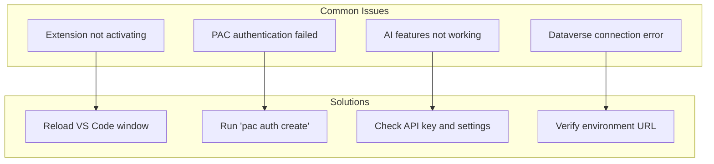

### Extension Not Activating

1. Check VS Code version (requires 1.85+)
2. Reload window: `Ctrl+Shift+P` > "Reload Window"
3. Check Output panel for errors
4. Reinstall extension

### PAC Authentication Failed

```powershell
# Clear existing auth
pac auth clear

# Create new authentication
pac auth create --environment https://your-env.crm.dynamics.com

# Verify
pac auth list
```

### AI Features Not Working

1. **Check Settings:**
   ```json
   {
     "fusionStudio.azureOpenAi.endpoint": "https://your-resource.openai.azure.com",
     "fusionStudio.azureOpenAi.deploymentName": "gpt-4"
   }
   ```

2. **Set API Key:**
   - Command: "Set Azure OpenAI API Key"
   - Enter your key when prompted

3. **Verify Connection:**
   - Try a simple chat message
   - Check Output panel for errors

### Dataverse Connection Error

1. Verify environment URL is correct
2. Check PAC authentication is active
3. Ensure user has appropriate Dataverse permissions
4. Try: Command "Reset Dataverse Client"

### Error Codes

| Code | Meaning | Solution |
|------|---------|----------|
| `PAC_AUTH_001` | Not authenticated | Run `pac auth create` |
| `PAC_AUTH_002` | Token expired | Re-authenticate |
| `DV_CONN_001` | Connection refused | Check firewall/VPN |
| `DV_PERM_001` | Permission denied | Check Dataverse roles |
| `AI_KEY_001` | Invalid API key | Re-enter API key |
| `AI_QUOTA_001` | Rate limited | Wait and retry |

---

## Getting Help

### Resources

- **GitHub Issues**: Report bugs and request features
- **Documentation**: `/docs` folder in repository
- **Logs**: View > Output > Fusion Studio

### Debug Mode

Enable verbose logging:

```json
// settings.json
{
  "fusionStudio.debug": true
}
```

### Contact

- Repository: [github.com/devladlog/Fusion-Studio](https://github.com/devladlog/Fusion-Studio)
- Issues: Use GitHub Issues for bug reports

---

## Quick Reference Card

```
╔══════════════════════════════════════════════════════════════╗
║                    FUSION STUDIO                             ║
║              Quick Reference Card                            ║
╠══════════════════════════════════════════════════════════════╣
║                                                              ║
║  SHORTCUTS                                                   ║
║  ─────────────────────────────────────────────────────────   ║
║  Ctrl+Shift+P     Command Palette                            ║
║  Ctrl+Shift+D     Open Dashboard                             ║
║  Ctrl+Shift+S     Open Power Apps Studio                     ║
║  Ctrl+Shift+C     Open AI Copilot                            ║
║                                                              ║
║  KEY COMMANDS                                                ║
║  ─────────────────────────────────────────────────────────   ║
║  > Fusion Studio: Open Dashboard                             ║
║  > Open Copilot Sidebar                                      ║
║  > Open Dataverse Designer                                   ║
║  > Open Flow Designer                                        ║
║  > Analyze PowerFx                                           ║
║  > Set Azure OpenAI API Key                                  ║
║                                                              ║
║  STATUS BAR                                                  ║
║  ─────────────────────────────────────────────────────────   ║
║  🟢 Connected    🟡 Pending    🔴 Disconnected               ║
║                                                              ║
╚══════════════════════════════════════════════════════════════╝
```

---

*Fusion Studio v0.4.2 - Power Apps Engineering Superpowers*
