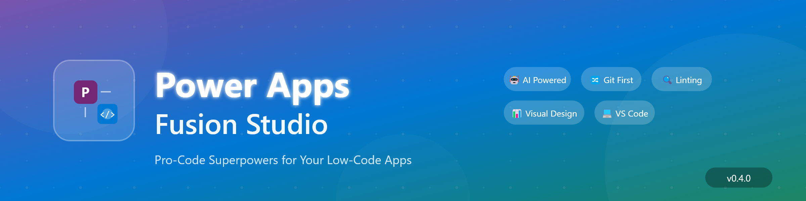
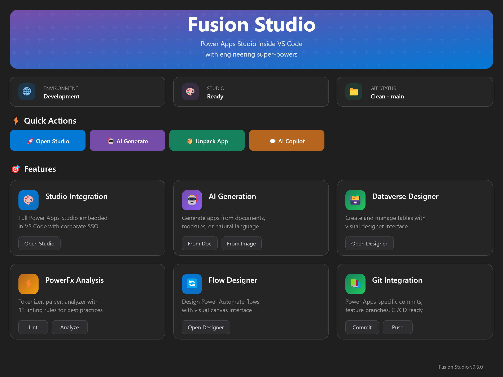
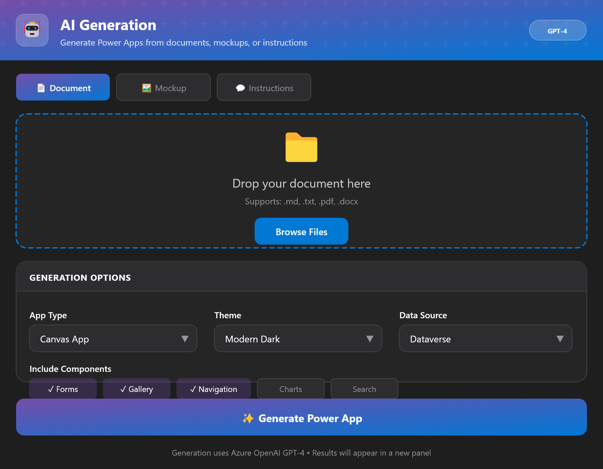
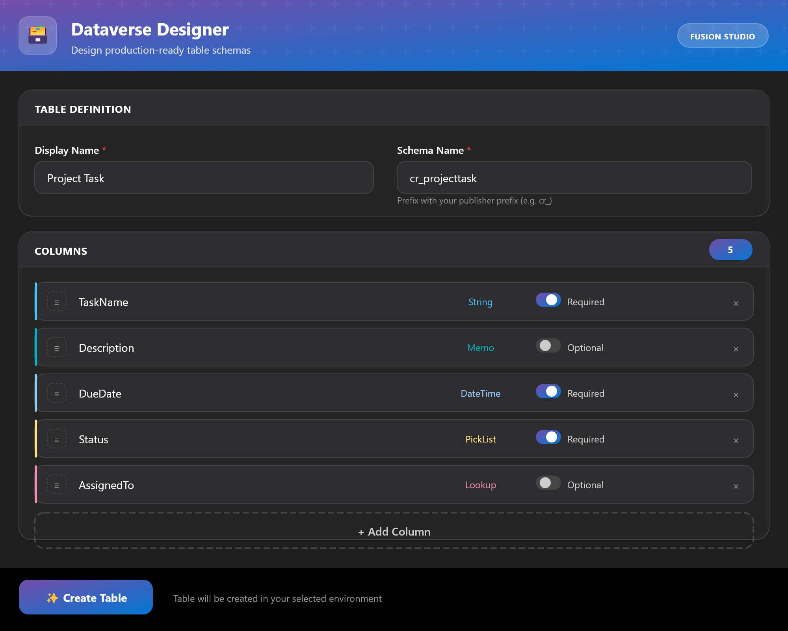
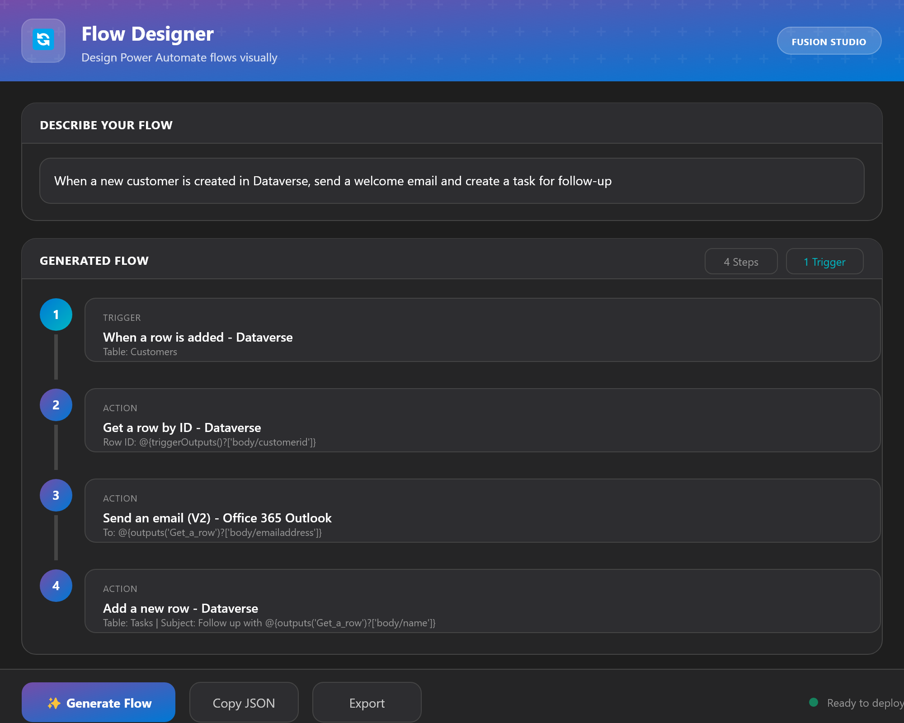
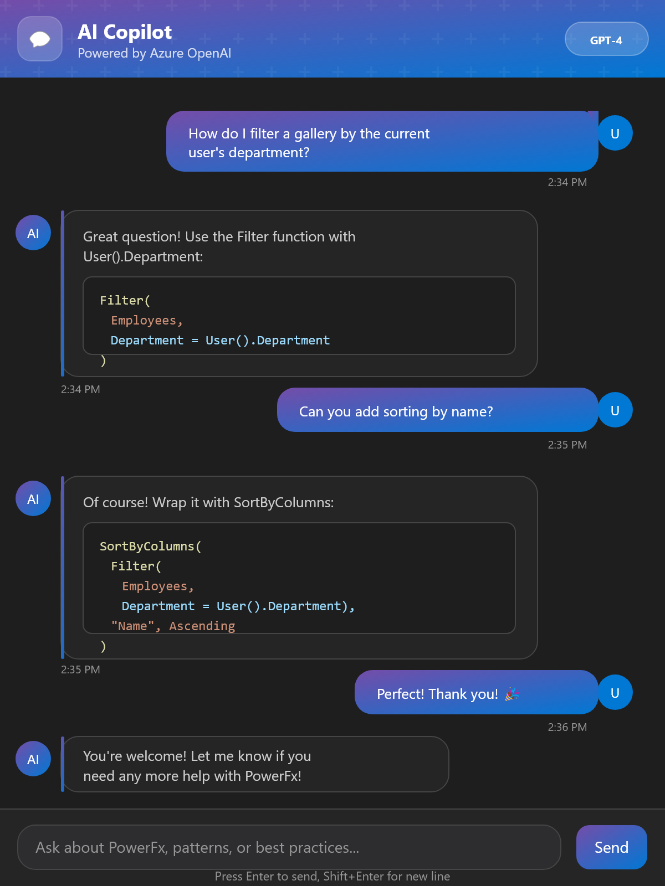
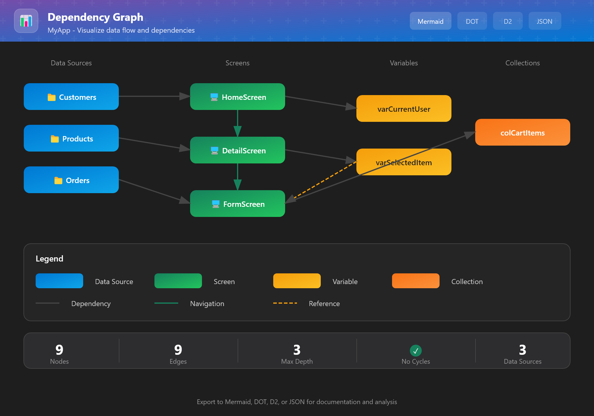

<p align="center">
  
</p>

<p align="center">
  <strong>🚀 The Ultimate Power Platform Development Experience in VS Code</strong>
</p>

<p align="center">
  <a href="https://marketplace.visualstudio.com/items?itemName=VladimiroLuis.powerapps-fusion-studio">
    
  </a>
  <a href="https://marketplace.visualstudio.com/items?itemName=VladimiroLuis.powerapps-fusion-studio">
    
  </a>
  <a href="https://marketplace.visualstudio.com/items?itemName=VladimiroLuis.powerapps-fusion-studio">
    
  </a>
  <a href="https://github.com/devladlog/Fusion-Studio/blob/main/LICENSE">
    
  </a>
</p>

<br>

<p align="center">
  <a href="#-highlights">Highlights</a> •
  <a href="#-features">Features</a> •
  <a href="#-installation">Installation</a> •
  <a href="#-quick-start">Quick Start</a> •
  <a href="#-ai-setup">AI Setup</a>
</p>

<br>

---

<br>

## ✨ Highlights

<table>
<tr>
<td align="center" width="25%">

<br><br>
<strong>AI Generation</strong><br>
<sub>Create apps from docs, mockups, or plain English</sub>
</td>
<td align="center" width="25%">

<br><br>
<strong>Visual Designers</strong><br>
<sub>Dataverse tables & Power Automate flows</sub>
</td>
<td align="center" width="25%">

<br><br>
<strong>PowerFx Linting</strong><br>
<sub>12 rules, AST parsing, and insights</sub>
</td>
<td align="center" width="25%">

<br><br>
<strong>Version Control</strong><br>
<sub>Native Git workflows for Power Apps</sub>
</td>
</tr>
</table>

<br>

---

<br>

## 🎯 Why Power Apps Fusion Studio?

**Power Apps Fusion Studio** transforms VS Code into a complete Power Platform development environment. No more switching between browser tabs - get **pro-code superpowers** for your low-code apps.

<p align="center">
  
</p>

<br>

### 💎 For Developers

| Feature | Benefit |
|:--------|:--------|
| 🖥️ Native VS Code | Your favorite editor, your favorite shortcuts |
| 🤖 AI Code Gen | Generate complete apps with GPT-4 |
| 📝 PowerFx IntelliSense | Autocomplete, hover docs, go-to-definition |
| ⚡ Real-time Linting | Catch issues before they become problems |

### 👥 For Teams

| Feature | Benefit |
|:--------|:--------|
| 🔀 Git Integration | Branch, merge, PR - just like real code |
| 📊 Dependency Graphs | Visualize & document your app structure |
| 🚀 CI/CD Templates | Azure DevOps & GitHub Actions ready |
| 📋 Code Reviews | Review Power Apps changes like any PR |

<br>

---

<br>

## 🚀 Features

<br>

### 🤖 AI-Powered Generation

Generate complete Power Apps from **documents**, **mockups**, or **natural language** using Azure OpenAI.

<table>
<tr>
<td width="45%">

**📄 From Documents**
<br>Upload markdown, PDF, or Word docs and let AI create your app schema.

**🎨 From Mockups**
<br>Turn wireframes and designs into working Power Apps screens.

**💬 From Instructions**
<br>Describe what you need - AI builds it for you.

</td>
<td width="55%">

</td>
</tr>
</table>

<br>

---

<br>

### 🗃️ Dataverse Designer

Create and manage **Dataverse tables** with an intuitive visual designer - no browser required.

<p align="center">
  
</p>

<table>
<tr>
<td align="center">📝 <strong>Text</strong></td>
<td align="center">🔢 <strong>Number</strong></td>
<td align="center">💰 <strong>Currency</strong></td>
<td align="center">📅 <strong>DateTime</strong></td>
<td align="center">📋 <strong>Choice</strong></td>
<td align="center">🔗 <strong>Lookup</strong></td>
</tr>
<tr>
<td align="center">✅ <strong>Yes/No</strong></td>
<td align="center">📎 <strong>File</strong></td>
<td align="center">🖼️ <strong>Image</strong></td>
<td align="center">⚡ <strong>Formula</strong></td>
<td align="center">🔢 <strong>AutoNumber</strong></td>
<td align="center">🆔 <strong>GUID</strong></td>
</tr>
</table>

<br>

---

<br>

### ⚡ Flow Designer

Design **Power Automate flows** with a modern visual interface - create, edit, and preview flows directly in VS Code.

<p align="center">
  
</p>

<br>

---

<br>

### 💬 AI Copilot Chat

Your intelligent assistant for Power Platform development. Get instant help with formulas, architecture, debugging, and best practices.

<p align="center">
  
</p>

<br>

---

<br>

### 🔍 PowerFx Analysis Engine

Professional-grade code analysis that parses your formulas into an **Abstract Syntax Tree** and runs **12 linting rules**.

<table>
<tr>
<td width="50%">

| Rule | Description |
|:-----|:------------|
| 🎨 `no-hardcoded-colors` | Use theme colors |
| 🪆 `no-nested-if` | Limit nesting depth |
| 🔢 `no-magic-numbers` | Extract constants |
| 🔀 `prefer-switch` | Cleaner conditionals |
| ⚠️ `no-empty-handler` | Detect empty handlers |
| 📏 `max-line-length` | Readable code |

</td>
<td width="50%">

| Rule | Description |
|:-----|:------------|
| 🏷️ `naming-convention` | Consistent names |
| 💾 `no-direct-updates` | Control patterns |
| 🔁 `no-circular-refs` | Prevent loops |
| 📊 `data-source-usage` | Optimize calls |
| 🧹 `unused-variables` | Clean code |
| 📝 `require-comments` | Document logic |

</td>
</tr>
</table>

<br>

---

<br>

### 📊 Dependency Graphs

Visualize your app's data flow with beautiful, **exportable dependency graphs**.

<p align="center">
  
</p>

<table>
<tr>
<td align="center" width="25%">

<br><sub>GitHub/GitLab native</sub>
</td>
<td align="center" width="25%">

<br><sub>Graphviz format</sub>
</td>
<td align="center" width="25%">

<br><sub>Declarative diagrams</sub>
</td>
<td align="center" width="25%">

<br><sub>Custom processing</sub>
</td>
</tr>
</table>

<br>

---

<br>

### 🔀 Git Integration

Native **Git workflows** designed specifically for Power Apps development.

<table>
<tr>
<td align="center" width="20%">📦<br><strong>Unpack</strong><br><sub>.msapp to source</sub></td>
<td align="center">➡️</td>
<td align="center" width="20%">✏️<br><strong>Edit</strong><br><sub>PowerFx files</sub></td>
<td align="center">➡️</td>
<td align="center" width="20%">💾<br><strong>Commit</strong><br><sub>Smart messages</sub></td>
<td align="center">➡️</td>
<td align="center" width="20%">🚀<br><strong>Push</strong><br><sub>To remote</sub></td>
<td align="center">➡️</td>
<td align="center" width="20%">📦<br><strong>Pack</strong><br><sub>Deploy</sub></td>
</tr>
</table>

<br>

---

<br>

## 📦 Installation

### From VS Code Marketplace

1. Open **VS Code**
2. Press `Ctrl+Shift+X` to open Extensions
3. Search **"Power Apps Fusion Studio"**
4. Click **Install**

### From VSIX File

Download the `.vsix` file and run:

```powershell
code --install-extension powerapps-fusion-studio-0.4.2.vsix
```

<br>

---

<br>

## ⚡ Quick Start

<table>
<tr>
<td width="50px" align="center"><h3>1</h3></td>
<td>

**Open Dashboard**

Press `Ctrl+Shift+P` and run `Power Apps: Open Fusion Studio Dashboard`

</td>
</tr>
<tr>
<td align="center"><h3>2</h3></td>
<td>

**Connect Environment**

Run `Power Apps: Select Environment` to connect to Power Platform

</td>
</tr>
<tr>
<td align="center"><h3>3</h3></td>
<td>

**Unpack an App**

Run `Power Apps: Unpack Canvas App` to extract for editing

</td>
</tr>
<tr>
<td align="center"><h3>4</h3></td>
<td>

**Start Building! 🚀**

Use AI generation, edit formulas, and version control with Git

</td>
</tr>
</table>

<br>

---

<br>

## 🤖 AI Setup

To enable AI-powered features, configure **Azure OpenAI**:

### Step 1: Create Azure OpenAI Resource

Create an [Azure OpenAI resource](https://portal.azure.com) and deploy a **GPT-4** model.

### Step 2: Configure Extension

Open VS Code Settings (`Ctrl+,`) and set:

| Setting | Value |
|:--------|:------|
| `powerapps.azureOpenAi.endpoint` | `https://YOUR-RESOURCE.openai.azure.com` |
| `powerapps.azureOpenAi.deploymentName` | `gpt-4` |

### Step 3: Set API Key

Run: `Power Apps: Set Azure OpenAI API Key`

> 🔐 API keys are stored securely in VS Code's secret storage.

<br>

---

<br>

## ⌨️ Keyboard Shortcuts

| Shortcut | Action |
|:---------|:-------|
| `Ctrl+Shift+P` | Command Palette |
| `Ctrl+Shift+D` | Open Dashboard |
| `Ctrl+Shift+L` | Lint Current Formula |
| `Ctrl+Shift+G` | Export Dependency Graph |

<br>

---

<br>

## 📋 Requirements

| Requirement | Version | Notes |
|:------------|:--------|:------|
| VS Code | 1.85.0+ | Required |
| PAC CLI | Latest | [Install Guide](https://docs.microsoft.com/power-platform/developer/cli/introduction) |
| Node.js | 18+ | For development |
| Azure OpenAI | - | Optional, for AI features |

<br>

---

<br>

## 📄 License

This project is licensed under the **MIT License** - see the [LICENSE](LICENSE) file for details.

<br>

---

<br>

<p align="center">
  <strong>Built with ❤️ by <a href="https://www.devladlog.com">Vladimiro Luis</a></strong>
</p>

<p align="center">
  <a href="https://github.com/devladlog/Fusion-Studio">⭐ Star on GitHub</a> •
  <a href="https://github.com/devladlog/Fusion-Studio/issues/new?template=bug_report.md">🐛 Report Bug</a> •
  <a href="https://github.com/devladlog/Fusion-Studio/issues/new?template=feature_request.md">💡 Request Feature</a>
</p>
